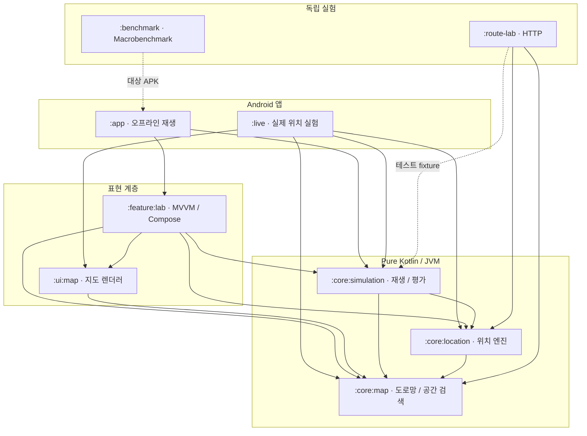
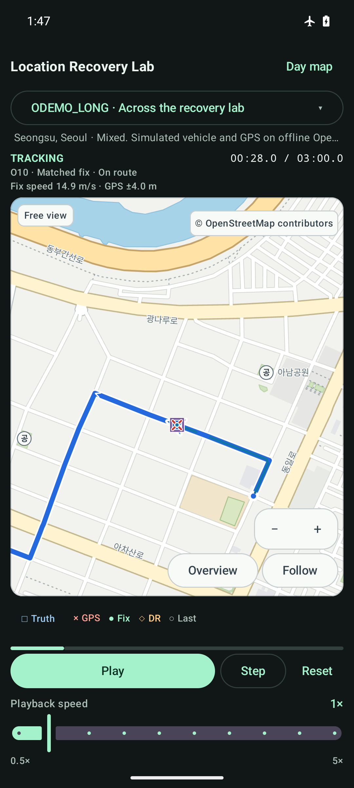

# Location Recovery Lab

국내 실제 도로망 위에서 GPS 오류와 신호 손실을 재현하고, **위치 복구 알고리즘·Android 지도 렌더링·플랫폼 및 네트워크 신뢰성**을 검증하는 Kotlin 기반 실험 프로젝트다.

국내 OpenStreetMap 지도 10개 지역을 앱에 포함해 외부 지도 SDK와 서버 없이 실행한다. 가상 주행은 결정적으로 재현할 수 있으며 실제 Android 위치 추적과 HTTP 장애 실험은 별도 실행 환경으로 분리했다.

[아키텍처](docs/architecture.md) · [성능 측정](docs/refactor-performance.md) · [장애 분석](docs/stability-investigation.md) · [검증 결과](docs/verification.md) · [실행 방법](#quick-start)

## 핵심 성과

| 문제 | 해결 방법 | 결과 및 근거 |
|---|---|---|
| 대규모 도로망의 매칭 비용 | 순수 Kotlin Spatial Grid | O10 관측당 처리 시간 중앙값 **42.30 → 7.73µs (81.7% 감소)**, 기존 판정 일치 · [성능](docs/refactor-performance.md) |
| Android 8·48MiB 앱 힙의 OOM 및 OS 메모리 종료 | Streaming JSON parsing, 저메모리 Software Canvas와 viewport bitmap 재사용 | Native Heap PSS 최대 관측값 **336,244 → 15,834KiB (95.3% 감소)**, 동일 환경 반복 검증 · [장애 분석](docs/stability-investigation.md) |
| GPS 점프·터널 손실·평행도로 | Map Matching, 제한적 Dead Reckoning(DR), 재획득·이탈 판단 | 합성·OSM·고난도 가상 평가 **84개**, 로딩 오류 검사 3개 통과 · [평가](docs/verification.md) |
| 권한 변경·Activity 재생성·백그라운드 위치 | LocationManager, Foreground Service, 제한된 callback queue와 자원 해제 | API 26·31·33·34·36 에뮬레이터, API 31 실기기 GPS 수신 및 FGS 시작·정지 20회 · [Live](docs/live-location.md) |
| HTTP 실패·중복·응답 역전 | Timeout, Retry/Backoff, 취소, 요청 세대·경로 버전 검증 | 로컬 HTTP 테스트 **17개**, N01–N15 검증 · [네트워크](docs/network-reliability.md) |

위치 매칭은 O10의 18,490개 방향성 에지를 대상으로 한 JVM 7회 반복 중앙값이다. 메모리 수치는 스트리밍만 적용한 중간 빌드와 렌더링 수정 후 빌드의 Native Heap PSS 최대 표본이며 전체 프로세스 메모리가 아니다.

## 시스템 아키텍처

9개 Gradle 모듈을 앱, 표현 계층, 순수 Kotlin/JVM 코어, 독립 실험으로 나눈다. 실선은 선언 의존성, 점선은 테스트 경계다.



코어는 Android 의존성 없이 JVM에서 검증한다. 엔진에는 표현용 단순화 데이터나 Ground Truth를 전달하지 않는다. 기본 앱은 위치·인터넷 권한 없이 동작하며 Live 앱은 별도 APK다. HTTP 실험은 두 APK에 포함되지 않는다. `verifyModuleBoundaries`로 의존성 방향을 검사한다.

**[전체 설계 및 데이터 흐름 보기 →](docs/architecture.md)**

## 실행 화면

<p align="center">
  <a href="docs/demo/refactor/O10-mid.png"></a>
  <a href="docs/demo/refactor/O07-follow.png"></a>
</p>

<p align="center">성수동 O10 · Mid &nbsp; | &nbsp; 운중동 O07 · Follow</p>

성능 리팩터링 이후 실제 캡처다. 클릭하면 원본을 볼 수 있다. [국내 10개 지도 전체 화면](docs/osm-visual-verification.md) · [대표 시나리오 실행](docs/demo.md)

## 주요 구현

| 영역 | 설계 및 구현 |
|---|---|
| 위치 처리 | 관측 품질·시간·이동 검사, 도로 투영과 후보 점수, 모호성 보류, 15초 한도의 DR, 연속 관측 기반 복구·이탈 · [알고리즘](docs/algorithm.md) |
| 공간 데이터 | Geofabrik 대한민국 PBF → EPSG:5179 로컬 미터 → 방향성 도로 그래프와 회전 제한, 표현용 지형 JSON · [파이프라인](docs/osm-data-pipeline.md) |
| 지도 렌더러 | Compose Canvas, LOD, Viewport Culling, Spatial Grid, Path·라벨 캐시, 비동기 준비, 저메모리 fallback · [지도 설계](docs/korea-map-design.md) |
| 재생과 평가 | Monotonic clock, ReplayController, 제한된 이력, 결정적 재생 및 독립 Ground Truth 평가 · [재생 설계](docs/architecture.md#결정적-재생과-취소) |
| Android 위치 추적 | LocationManager, FGS, 정밀·대략 권한, 지도 범위 검사, 세션 정리, 실제 위치의 외부 전송·저장 없음 · [Live 정책](docs/live-location.md) |
| HTTP 실험 | OkHttp + MockWebServer, timeout·backoff·취소·응답 정합성, 기존 유효 경로 보호 · [장애 매트릭스](docs/network-reliability.md) |

## 성능과 장애 대응

| 비교 대상 | 기준선 | 개선 후 | 환경 |
|---|---:|---:|---|
| O10 Map Matching 중앙값 | 42.30µs | 7.73µs | JVM, 7회 |
| 지도 전환 Frame CPU P95 | 111.3ms | 66.4ms | P25–P32, API 36 에뮬레이터 |
| O10 주행·카메라 Frame CPU P95 | 389.8ms | 375.7ms | 동일 단계, API 36 에뮬레이터 |
| O10 콜드 TTFD 중앙값 | 1,283.3ms | 1,253.0ms | 동일 단계, API 36 에뮬레이터 |

Android 비교는 각 3회 측정이며 초기 리팩터링과 기준선이 다르다. 초기 리팩터링에서는 일부 로딩 시간이 증가했고, 최신 에뮬레이터의 주행 프레임 지연도 크게 남아 있다.

API 26·48MiB 환경의 OOM 및 메모리 종료를 재현하고 수정했다. ANR·Crash는 Debug 하네스에서 의도적으로 재현해 OS 종료 이력을 분석했다. 일반 앱의 ANR 발생률이나 장기 누수율을 측정한 것은 아니다.

[성능과 트레이드오프](docs/refactor-performance.md) · [ANR·Crash·OOM 분석](docs/stability-investigation.md)

## 검증 상태

| 항목 | 기록된 결과 |
|---|---|
| JVM·Android 단위 테스트 | 70개 통과 |
| 합성·장시간·OSM·고난도 평가 | 84개 및 로딩 오류 3개 통과 |
| 플랫폼 계측 | API 26·31·33·34·36 대표 에뮬레이터 |
| 저메모리 반복 | API 26·48MiB O10 기동, 지도 전환·재생 및 Live 시작·종료 각각 20회 |
| CI·패키징 | 모듈 경계, Lint, Debug/unsigned Release, APK 격리, API 36 Live CI 통과 |

[검증 이력과 재현 명령](docs/verification.md) · [구현 기준 main CI](https://github.com/CodingBot000/AndroidLocaltionRecovery/actions/runs/45595529668) (`d0b3822`)

**실기기 재검증:** API 31에서 실제 GPS 수신과 FGS·listener 해제를 확인했다. 과거 120초 무수신은 이번 조건에서 재현되지 않아 원인은 미확정이다. O10 콜드 TTFD 중앙값은 1,871.8→1,343.9ms였고 주행·카메라 시한 초과 P95는 78.8→102.1ms였다. O10 1× 재생 30분이 통과했다. 전력 A/B는 미실행이다. [실기기 최종 검증](docs/real-device-final-validation.md)

## 기술 스택

| 구분 | 기술 |
|---|---|
| Android | Kotlin, Jetpack Compose, MVVM, Coroutines, StateFlow, LocationManager, Foreground Service |
| 지도·데이터 | OpenStreetMap, Python, pyproj, Shapely, NetworkX, EPSG:5179, Gson Streaming |
| 네트워크 | OkHttp, MockWebServer |
| 품질·성능 | JUnit, Android Instrumentation, Macrobenchmark, Perfetto, atrace, ApplicationExitInfo, GitHub Actions |

## Quick Start

JDK 17, Android SDK 36 및 command-line tools가 필요하다. 최소 API는 26이다. SDK 위치는 Android Studio 또는 `ANDROID_HOME`에서 설정한다.

**기본 오프라인 앱**

```bash
./gradlew :app:assembleDebug
adb install -r app/build/outputs/apk/debug/app-debug.apk
adb shell am start -n lab.recovery.app/.MainActivity
```

기본 ODEMO_LONG(성수동, 가상 180초) 또는 터널 손실 OL06·OL07을 선택한다. 위치·인터넷 권한은 필요 없다.

**Live 위치 실험 (별도 APK)**

```bash
./gradlew :live:assembleDebug
adb install -r live/build/outputs/apk/debug/live-debug.apk
```

지도와 선택적 계획 경로를 고른 뒤 권한을 허용하고 Start를 누른다. [실행 및 권한 조건](docs/live-location.md)

**HTTP 실험과 핵심 회귀**

```bash
./gradlew verifyModuleBoundaries :core:map:test :core:location:test :core:simulation:test \
  :feature:lab:testDebugUnitTest :ui:map:testDebugUnitTest :app:testDebugUnitTest \
  :live:testDebugUnitTest :route-lab:test
python3 -B tools/osm/verify.py
```

전체 빌드·계측·평가 명령은 [검증 문서](docs/verification.md), 데이터 재생성은 [OSM 파이프라인](docs/osm-data-pipeline.md)에 있다.

## 상세 문서

| 목적 | 문서 |
|---|---|
| 설계 | [전체 아키텍처](docs/architecture.md) · [위치 알고리즘](docs/algorithm.md) · [지도 렌더링](docs/korea-map-design.md) |
| 데이터 및 화면 | [OSM 전처리](docs/osm-data-pipeline.md) · [데모](docs/demo.md) · [지도 갤러리](docs/osm-visual-verification.md) |
| 문제 해결 | [성능 리팩터링](docs/refactor-performance.md) · [렌더링·메모리 RCA](docs/rendering-memory-rca.md) · [장애 조사](docs/stability-investigation.md) · [Compose 계측 RCA](docs/compose-slot-table-rca.md) |
| 플랫폼·HTTP | [Live 위치](docs/live-location.md) · [네트워크 신뢰성](docs/network-reliability.md) |
| 검증 | [통합 검증](docs/verification.md) · [실기기 이력](docs/physical-device-validation.md) · [OSM 평가](docs/osm-evaluation-report.md) · [고난도 평가](docs/osm-challenge-report.md) |
| 이전 평가 | [기본 합성](docs/evaluation-report.md) · [장시간 합성](docs/extended-evaluation-report.md) |

## 범위 및 라이선스

실제 OSM 도로 형상을 사용하지만 기본 앱의 GPS 관측과 차량 움직임은 가상이다. Live는 선택한 지도 범위와 계획 경로에서 위치 엔진을 연결한다. HTTP 실험은 상용 서버나 모바일 네트워크 검증이 아니다. 실제 GNSS 정확도 또는 상용 내비게이션의 성능을 보장하지 않는다.

© OpenStreetMap contributors · 지도 파생 데이터: ODbL 1.0. [출처 및 라이선스](data/osm/README.md).
