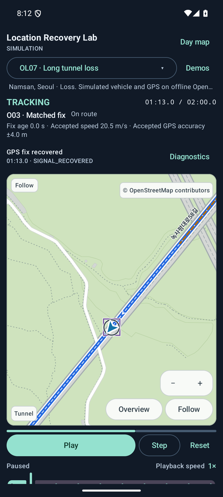
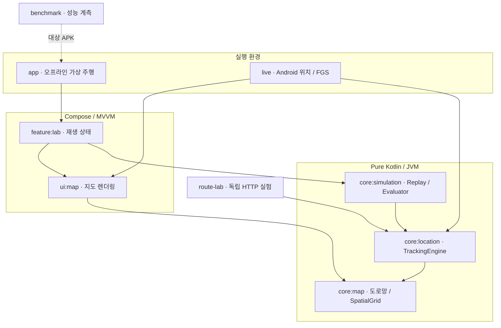

# Location Recovery Lab

**Kotlin · Jetpack Compose 기반 Android 위치 복구 및 지도 렌더링 실험**

GPS 신호가 불안정하거나 끊기는 상황에서 위치 판단과 화면 상태를 안전하게 유지하기 위해 국내 실제 도로망을 이용해 위치 처리 엔진, Android 생명주기, 렌더링 성능 및 장애 대응을 설계하고 검증한 개인 프로젝트다.

외부 지도 SDK 없이 국내 OpenStreetMap 10개 지역을 오프라인으로 표시한다. 가상 주행, 실제 Android 위치 수신, HTTP 장애 실험을 독립 실행 환경으로 분리하여 동작을 재현하고 검증할 수 있다.

[전체 아키텍처](docs/architecture.md) · [지도 전환 성능 조사](docs/recovery-ui-switch-rca.md) · [실기기 성능 이력](docs/rendering-memory-rca.md) · [장애 대응](docs/stability-investigation.md) · [검증 결과](docs/verification.md) · [전체 문서 안내](docs/index.md)

<p align="center">
  <a href="docs/demo/recovery-ui/ol07-tracking.png"></a>
  <a href="docs/demo/recovery-ui/ol07-estimating.png"></a>
  <a href="docs/demo/recovery-ui/ol07-recovered.png"></a>
</p>
<p align="center">남산 터널 OL07 · 정상 추적 28초 &nbsp; | &nbsp; DR 추정 54초 &nbsp; | &nbsp; 정상 복구 73초</p>

기본 앱에서 **대표 사례(Demos) → OL07 → 배속 버튼 → 5× → 재생(Play)** 순으로 테스트한다. 63초에는 추정 상한에 도달해 마지막 확인 위치로 전환한다. [63초 추정 중단 화면](docs/demo/recovery-ui/ol07-last-known.png) · [OL07 시연 절차](docs/demo.md#ol07-시연) · [지도 갤러리](docs/osm-visual-verification.md) · [UI 검증 및 성능 비교](docs/recovery-ui-validation.md)

## 핵심 구현 및 검증 성과

| 기술 과제 | 설계·해결 | 검증 근거 |
|---|---|---|
| GPS 이상치·신호 손실·경로 이탈 | Map Matching, 신호 상태기계, 최대 15초 Dead Reckoning, 연속 관측 기반 복구 | 가상 위치 평가 84개 및 로딩 오류 3개 통과 · [알고리즘](docs/algorithm.md) |
| 복잡한 도로망의 위치 매칭 비용 | 원본 도로의 Spatial Grid와 결정적 후보 판정 | O10 관측당 처리 시간 중앙값 **42.30 → 7.73µs (81.7% 감소)**, 기존 판정 일치 · [성능](docs/refactor-performance.md#jvm-도로-매칭) |
| Android 8 저메모리 환경 | Streaming JSON parsing, Software Canvas, viewport bitmap 재사용 | API 26·48MiB에서 OOM·OS 메모리 종료 수정, O10 기동 및 전환·재생·Live 각 20회 검증 · [장애 분석](docs/stability-investigation.md) |
| 실제 위치 수신 및 자원 수명 | LocationManager, 위치 Foreground Service, 권한별 처리, 세션 토큰·제한 큐 | API 26·31·33·34·36 에뮬레이터 수명 검증. 과거 API 31 실기기에서 새 GPS 관측 수신 및 별도 FGS·리스너 시작·해제 20회 · [Live](docs/live-location.md) |
| HTTP 요청 장애 및 응답 역전 | Timeout, bounded retry/backoff, 취소, 요청 generation 및 경로 version 확인 | 독립 JVM loopback HTTP 테스트 17개와 APK 격리 검사 · [네트워크](docs/network-reliability.md) |

매칭 시간은 18,490개 방향성 에지를 가진 O10에서 JVM 7회 반복 측정한 값이다. 위치 평가는 재현 가능한 가상 관측의 판정 계약 검증이며 실제 주행 정확도 통계가 아니다. 실기기의 GPS 수신과 짧은 서비스 반복 시험은 별개다.

## 아키텍처

Kotlin·Compose·MVVM 표현 계층, 순수 Kotlin 위치·도로·시뮬레이션 코어, Android 플랫폼 어댑터를 Gradle 모듈로 분리했다. 도메인 엔진은 UI와 Android 위치 API에 의존하지 않는다.



위 그림은 주요 책임과 의존 관계를 요약한다. 실제 9개 모듈의 전체 Gradle 선언 의존성과 재생·지도·Live 데이터 흐름은 **[상세 아키텍처](docs/architecture.md)** 에 있다. `verifyModuleBoundaries`로 모듈 경계를 검증하며 Ground Truth와 렌더링용 단순화 데이터는 위치 판정에 사용하지 않는다.

## 성능 최적화와 품질 판단

### 1. 저메모리 환경의 OOM 해결

API 26·48MiB ART 힙에서 O10 지도 로딩 OOM을 재현했다. Streaming parsing으로 로딩을 수정한 뒤에도 Live 반복에서 네이티브 메모리 압박에 따른 OS 종료가 발생해, 해당 조건에 Software Canvas와 재사용 가능한 viewport bitmap을 적용했다.

| 같은 저메모리 환경 | Native Heap PSS 최대 관측값 |
|---|---:|
| 스트리밍 파싱만 적용 | 336,244KiB |
| 렌더링 수정 후 | 15,834KiB |

약 95.3% 감소한 값은 전체 프로세스 메모리가 아니라 Native Heap PSS 최대 관측값(각 13개·12개 표본)이다. 수정 후 동일 힙 조건에서 기본 앱 기동, 지도 전환·재생 20회, Live 시작·종료 20회를 통과했다.

[원인·수정·회귀 테스트](docs/stability-investigation.md#핵심-사례-저메모리-지도-oom)

### 2. 실기기 렌더링 후보 검증 및 기각

Macrobenchmark와 Perfetto FrameTimeline으로 UI·RenderThread 실행, 느린 프레임, 기동 완료 시간과 메모리 추세를 분석했다. 두 점 도로를 `Path` 대신 `Canvas.drawLine`으로 그리는 후보를 기존 구현과 비교했다.

| SM-G975N · API 31 | 기준선 | 실험 후보 |
|---|---:|---:|
| 지도 전환 Frame CPU P95 | 92.5ms | 62.0ms |
| 주행 Frame Overrun P95 | 68.5ms | 85.0ms |
| 콜드 기동 TTFD 중앙값 | 1,388.2ms | 1,808.9ms |
| 30분 재생·Reset 후 유휴 120초 전체 PSS | 389,423KiB | 363,655KiB |

**판단: 후보 기각, 기존 렌더러 유지.** 전환 CPU 및 유휴 PSS 개선에도 주행과 기동 성능이 회귀했다. 시나리오별 렌더링 9회, 빌드별 180초 재생·Reset 10회(내구 시험 각 1회), 화면 비교 및 Live 자원 해제를 검증했다. 순차 측정의 환경 편향과 반복 PSS 증가 원인의 불확실성을 명시하고 실험 패치와 익명화 데이터를 보존했다.

[실기기 RCA 및 재현 방법](docs/rendering-memory-rca.md) · [측정 데이터](docs/benchmarks/sm-g975n-render-memory-optimization.json) · [실험 PR #5](https://github.com/CodingBot000/AndroidLocaltionRecovery/pull/5)

### 3. 장애 분석과 재발 방지

| 사례 | 진단 및 검증 |
|---|---|
| 저메모리 OOM / OS 종료 | heap 제한·메모리 범주를 분리하여 재현하고 동일 조건에서 수정 후 반복 검증 |
| CI의 Compose 계측 종료 크래시 | 최초 WrongThread 예외와 후속 SlotTable 예외를 분리, 계측 dispatcher 및 UI 준비 조건 수정 · [RCA](docs/compose-slot-table-rca.md) |
| ANR / Crash 진단 | Debug 전용 하네스로 의도적 재현, OS 종료 이력·atrace 관측 · [장애 조사](docs/stability-investigation.md) |
| 위치 서비스 / 네트워크 자원 해제 | 세션 전환, FGS·리스너 해제, 늦은 HTTP 응답 폐기 및 결함 주입으로 회귀 검증 |

ANR·Crash는 진단용 하네스와 계측 환경의 재현 사례이며 상용 앱의 장애율 개선을 의미하지 않는다.

## 검증 및 CI

| 품질 게이트 | 기록된 결과 |
|---|---|
| JVM·Android 단위 테스트 | UI 후보 83개 통과 |
| 독립 위치 평가 | 합성·장시간·OSM·고난도 84개 및 로딩 오류 3개 통과 |
| Android 플랫폼 계측 | API 26·31·33·34·36 에뮬레이터, 권한·서비스 생명주기 및 접근성 검증 |
| 실기기 검증 이력 | 2026-11-25–26의 SM-G975N Android 12에서 fresh GPS 수신, Live 20회 시작·해제, O10 1× 재생 30분 및 성능을 측정했다. [빌드별 범위](docs/physical-device-validation.md) |
| 현재 UI 후보의 실기기 | SM-G975N 성능 본 측정과 콜드 재시험을 마쳤다. 기동 판정은 INCONCLUSIVE이며, 내구·GPS는 미실행이다. [G7 실기기 검증](docs/recovery-ui-physical-g7.md) |
| GitHub Actions | 모듈 경계·단위 테스트·Lint·Debug/unsigned Release APK·fixture·평가와 API 36 Live 계측 |

[UI 후보 PR 검사](https://github.com/CodingBot000/AndroidLocaltionRecovery/pull/9/checks) · [기존 main 73f728f 검사 이력](https://github.com/CodingBot000/AndroidLocaltionRecovery/actions/runs/45677049357) · [검증 이력 및 재현 명령](docs/verification.md)

## 기술 스택

| 구분 | 기술 |
|---|---|
| Android | Kotlin, Jetpack Compose, MVVM, Coroutines, StateFlow, LocationManager, Foreground Service |
| 지도·데이터 | OpenStreetMap, Spatial Grid, Canvas, Python, pyproj, Shapely, NetworkX, EPSG:5179, Gson Streaming |
| 네트워크 | OkHttp, MockWebServer (독립 JVM 실험) |
| 품질·성능 | JUnit, Android Instrumentation, Macrobenchmark, Perfetto, atrace, ApplicationExitInfo, GitHub Actions |

## Quick Start

JDK 17, Android SDK 36 및 command-line tools가 필요하다. 최소 API는 26이다. SDK 위치는 Android Studio 또는 `ANDROID_HOME`에서 설정한다.

**기본 오프라인 앱**

```bash
./gradlew :app:assembleDebug
adb install -r app/build/outputs/apk/debug/app-debug.apk
adb shell am start -n lab.recovery.app/.MainActivity
```

기본 ODEMO_LONG(성수동, 가상 180초) 또는 터널 손실 OL06·OL07을 선택한다. 위치·인터넷 권한은 필요 없다.

**Live 위치 실험 (별도 APK)**

```bash
./gradlew :live:assembleDebug
adb install -r live/build/outputs/apk/debug/live-debug.apk
```

지도와 선택적 계획 경로를 고른 뒤 권한을 허용하고 Start를 누른다. [실행 및 권한 조건](docs/live-location.md)

**HTTP 실험과 핵심 회귀**

```bash
./gradlew verifyModuleBoundaries :core:map:test :core:location:test :core:simulation:test \
  :feature:lab:testDebugUnitTest :ui:map:testDebugUnitTest :app:testDebugUnitTest \
  :live:testDebugUnitTest :route-lab:test
python3 -B tools/osm/verify.py
```

전체 빌드·계측·평가 명령은 [검증 문서](docs/verification.md), 데이터 재생성은 [OSM 파이프라인](docs/osm-data-pipeline.md)에 있다.

## 상세 문서

| 관심 영역 | 먼저 읽을 문서 |
|---|---|
| 시스템 설계·모듈 경계 | [아키텍처](docs/architecture.md) |
| 위치 처리·실제 Android 위치 | [알고리즘](docs/algorithm.md) · [Live 위치](docs/live-location.md) |
| 렌더링·데이터 설계 | [지도 렌더러](docs/korea-map-design.md) · [OSM 가공](docs/osm-data-pipeline.md) |
| 성능·장애 분석 | [성능 리팩터링](docs/refactor-performance.md) · [실기기 렌더링·메모리 RCA](docs/rendering-memory-rca.md) · [장애 분석](docs/stability-investigation.md) |
| HTTP 신뢰성 | [요청/응답·장애 매트릭스](docs/network-reliability.md) |
| 테스트·실기기·CI | [통합 검증](docs/verification.md) · [실기기 검증 범위](docs/physical-device-validation.md) |

[전체 기술 문서 및 과거 측정 이력 →](docs/index.md)

## 범위 및 라이선스

개인 실험 프로젝트다. 기본 앱은 실제 도로 형상을 사용하지만 GPS 관측과 차량 움직임은 가상이다. Live는 Android 위치 수신과 서비스 수명을 검증하며 HTTP는 로컬 테스트 서버에 격리했다. 실제 좌표는 Live 세션 메모리 밖으로 전송·저장하지 않는다. 수치와 테스트 결과는 명시된 환경에 한정한다.

© OpenStreetMap contributors · 지도 파생 데이터: ODbL 1.0. [출처 및 라이선스](data/osm/README.md).
