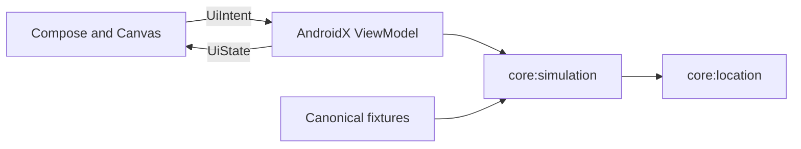

# Location Recovery Lab

합성 GPS 관측의 이상치와 저품질 입력을 검증하고, 도로 매칭·신호 손실·제한적 Dead Reckoning·재획득·경로 이탈을 재생하는 오프라인 Android 실험 앱이다. 지도는 미터 단위 로컬 직교 좌표로 그린다.


## 대표 시나리오

- **기본 데모**는 위치 점프, 신호 손실, DR, 재획득, 실제 경로 이탈이 한 번의 실행에서 나타난다.
- **S07**은 긴 터널 구간에서 DR 한도 도달 후 마지막 확인 위치를 표시한다.
- **S09·S10**은 불안정한 복구 후보와 평행 도로 매칭의 모호성을 보여준다.
- **S11·S16**은 분기 이탈과 신호 손실 중 실제 이탈을 구분한다.

샘플 선택 목록 아래에 상황과 확인할 결과가 표시된다. Play/Pause, Step, Reset으로 재생하고, 가로 슬라이더로 0.5×~5× 배속을 0.5× 단위로 고른다. 앱은 세로 모드로 실행한다. 지도에서 가상 실제 위치 표시를 전환할 수 있다. [재현 절차와 화면](docs/demo.md)

## 실행과 검증

JDK 17과 Android SDK 36을 설치하고 Gradle이 SDK를 찾도록 `ANDROID_HOME`을 설정하거나 Android Studio의 SDK 설정을 사용한다. 최소 실행 API는 26이다. 첫 빌드는 의존성을 내려받을 수 있어야 한다.

```bash
./gradlew :app:assembleDebug
adb install -r app/build/outputs/apk/debug/app-debug.apk
adb shell am start -n lab.recovery.app/.MainActivity

./gradlew :core:location:test :core:simulation:test :app:testDebugUnitTest
./gradlew :app:lintDebug :app:assembleRelease :app:assembleDebugAndroidTest
./gradlew :app:connectedDebugAndroidTest
./gradlew :core:simulation:run --args='fixtures/evaluation docs/evaluation-results.json docs/evaluation-report.md'
```

Android asset과 JVM 실행기는 루트 `fixtures/`의 동일 원본을 사용한다. fixture 버전과 SHA-256, 시드(해당 시), 실제 평가 설정은 JSON 결과에서 확인한다. 독립 기대값은 평가용 JSON의 `expected`에 있다.

## 구성



`:app`은 두 JVM 모듈을 사용한다. `:core:simulation`은 `:core:location`을 호출하며, 평가용 Ground Truth와 정답 라벨은 평가 및 시각화에만 전달한다. [아키텍처](docs/architecture.md)

Accuracy·수신 순서·지연·이동 가능성을 검사하고, 거리·방향·연결성·계획 경로로 후보 점수를 계산한다. DR은 정합 기준점에서 일정 속도를 가정하며 최대 15초 또는 명확한 경로가 끝나는 시점까지만 적용한다. 정상 복구는 연속 검증을 거친다. [알고리즘과 한계](docs/algorithm.md)

## 결과

| 검사 | 결과 확인 |
|---|---|
| JVM·Android 단위 테스트, Android 계측, Lint, 빌드 | 단위 24/24, 실제 단말 계측 6/6, Lint 오류 0건, APK 빌드 성공 · [검증 기록](docs/verification.md) |
| S01~S17 및 하위 사례의 기대 판정과 정량 지표 | 기대 판정과 로딩 검사 51/51 · [평가 요약](docs/evaluation-report.md), [JSON 원본](docs/evaluation-results.json) |
| APK 실행 및 데모 재현 | [데모 자료](docs/demo.md) |
| 실제 단말 오프라인 계측·성능 | [실제 단말 검증](docs/physical-device-validation.md) |

측정값의 범위는 가상 주행과 합성 도로다. 이 실험으로 실제 GNSS나 상용 내비게이션 엔진의 성능을 검증하지 않는다.
