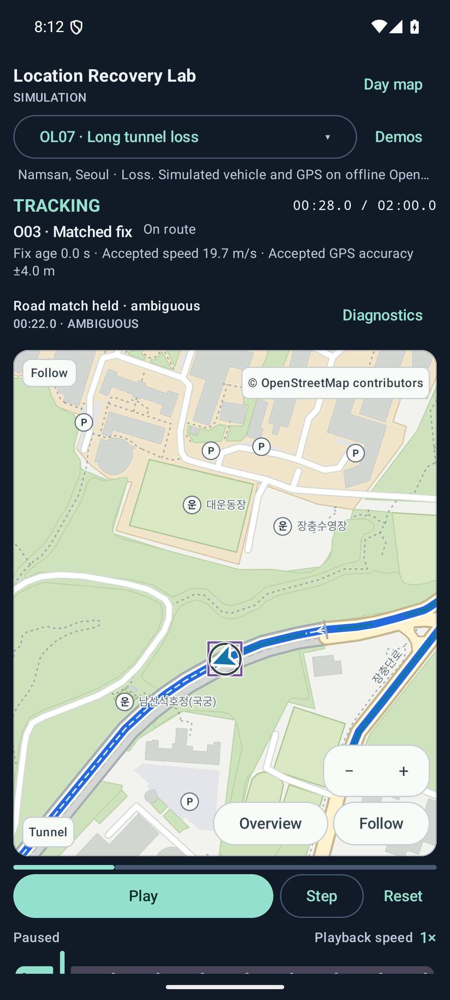
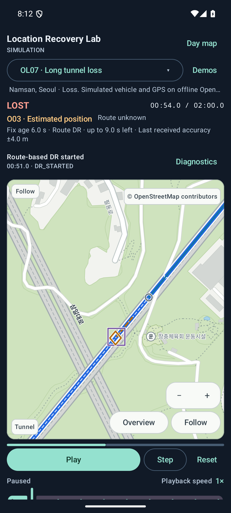

# Location Recovery Lab

**Android 위치 복구 엔진 · 오프라인 지도 렌더링 · 성능 최적화**

apk download link: [Download APK](https://github.com/CodingBot000/AndroidLocaltionRecovery/releases/latest/download/location-recovery-lab.apk)

GPS 이상치와 신호 손실 상황에서 언제 위치를 채택하고, 어디까지 추정하며, 언제 복구할지를 판단하는 Android 위치 처리 엔진입니다. Kotlin·Jetpack Compose로 구현했으며, 외부 지도 SDK 없이 국내 OpenStreetMap 10개 지역의 실제 도로망을 렌더링합니다.

Kotlin · Jetpack Compose · MVVM · Coroutines / StateFlow · Gradle Multi-Module · Macrobenchmark / Perfetto

[상세 아키텍처](docs/architecture.md#전체-9개-모듈) · [위치 알고리즘](docs/algorithm.md) · [성능 최적화](docs/refactor-performance.md) · [장애 분석](docs/stability-investigation.md)

## 핵심 성과

| **81.7%** 도로 매칭 처리 시간 감소 | **95.3%** Native Heap PSS 최대 관측값 감소 |
|---|---|
| 42.30 → 7.73µs/관측 · O10의 방향성 에지 18,490개, JVM 7회 비교 중앙값 · 기존 판정 일치. [Spatial Grid 측정](docs/refactor-performance.md#jvm-도로-매칭) | 336,244 → 15,834KiB · API 26·48MiB 저메모리 대응 실험의 스트리밍 파싱 적용 빌드 대비 렌더링 수정 후 최대 관측값(각 13·12개 표본). [OOM 해결](docs/stability-investigation.md#핵심-사례-저메모리-지도-oom) |
| **83개** JVM·Android 단위 테스트 통과 | **9개** Gradle 모듈 · 의존성 자동 검사 |
| 독립 위치 평가 결과 JSON 5종의 바이트 단위 동일성 및 실제 UI 재생 결과 검증. [자동화 검증](docs/verification.md#최신-구현-검증-요약) | 순수 Kotlin 코어, Compose 표현 계층, Android 위치 어댑터, 독립 HTTP 실험과 Benchmark 분리. [모듈 설계](docs/architecture.md#전체-9개-모듈) |

성능 수치는 각 최적화 당시의 명시된 환경과 비교 빌드에서 측정한 결과입니다.

## 대표 시연 · 남산 터널 OL07

<p align="center">
  <a href="docs/demo/recovery-ui/ol07-tracking.png"></a>
  <a href="docs/demo/recovery-ui/ol07-estimating.png"></a>
  <a href="docs/demo/recovery-ui/ol07-recovered.png"></a>
</p>
<p align="center">28초 정상 추적 &nbsp; | &nbsp; 54초 GPS 손실·DR 추정 &nbsp; | &nbsp; 73초 정상 복구</p>

실제 OSM 도로 형상에 가상 차량과 GPS 관측을 재생한 앱 실행 화면입니다. **대표 사례(Demos) → OL07 → 5× → 재생(Play)** 으로 주요 판정 흐름을 확인할 수 있습니다. [63초 추정 중단](docs/demo/recovery-ui/ol07-last-known.png) → [71초 재획득 후보](docs/demo/recovery-ui/ol07-recovering.png) → [주행 평가 결과](docs/demo/recovery-ui/ol07-complete-results.png).

[시연 및 다른 장애 시나리오](docs/demo.md) · [국내 10개 지도 갤러리](docs/osm-visual-verification.md)

## 핵심 기술 성과

| 기술 영역 | 문제 해결 및 구현 |
|---|---|
| **위치 처리 엔진** | 시간 역전·중복·위치 점프를 검사하고 원본 도로의 Spatial Grid, 방향·연결성 기반 Map Matching으로 후보를 판단합니다. 신호 손실 시 최대 15초 Dead Reckoning, 모호한 분기·추정 한도에서 중단, 연속 유효 관측으로 위치 재획득 및 경로 이탈·복귀를 판정합니다. [알고리즘](docs/algorithm.md) |
| **지도·메모리 최적화** | 실제 도로망과 렌더링 geometry 분리, Viewport Culling·LOD·Path 캐시, 정적·동적·라벨 Canvas 분리. API 26·48MiB에서 OOM과 OS 종료를 재현하고 Streaming JSON parsing 및 Software Canvas의 viewport bitmap 재사용으로 대응했습니다. [렌더링 설계](docs/korea-map-design.md) · [저메모리 RCA](docs/stability-investigation.md#핵심-사례-저메모리-지도-oom) |
| **성능 계측·원인 분석** | Macrobenchmark·Perfetto·FrameTimeline으로 기동·지도 전환·주행을 분리 측정했습니다. 실제 첫 프레임 present와 UIAutomator의 접근성 관측 지연을 요청 단위로 연결하고 캐시 대조 실험으로 구간을 격리했습니다. 별도 렌더러 A/B에서는 기동·주행까지 비교해 수용 기준을 충족하지 못한 후보를 기각했습니다. [지도 전환 RCA](docs/recovery-ui-switch-rca.md) · [렌더러 선택](docs/rendering-memory-rca.md) |
| **Android 플랫폼·안정성** | LocationManager, 위치 FGS, 권한별 처리, 실행 세대 및 제한 큐로 세션을 관리합니다. SM-G975N에서 Live 시작·종료 20회의 서비스·리스너 해제를 확인했습니다. Debug 장애 하네스로 ANR·Crash를 재현하고 ApplicationExitInfo·trace로 진단했습니다. Compose 계측의 최초 WrongThread와 후속 SlotTable 예외를 구분해 테스트 동기화를 수정했습니다. [Live 설계](docs/live-location.md) · [장애 분석](docs/stability-investigation.md) · [Compose RCA](docs/compose-slot-table-rca.md) |
| **네트워크 신뢰성** | 독립 JVM HTTP 경로 요청 실험에서 OkHttp timeout·제한된 retry/backoff·취소, generation/version 검증으로 오래된 응답을 폐기하고 유효한 기존 경로를 보호합니다. MockWebServer 기반 테스트 17개로 장애 계약을 검증했습니다. [네트워크 설계·테스트](docs/network-reliability.md) |
| **회귀 테스트 및 CI** | JVM·Android 단위 테스트 83개, API 26·31·33·34·36 에뮬레이터의 플랫폼 계측, TalkBack 및 소형 화면 검증. 결정적 가상 위치 평가와 Android 1×·5× 재생의 결과를 대조하고 모듈 경계·APK·fixture·Lint·테스트를 GitHub Actions로 검증합니다. [검증 및 재현](docs/verification.md) · [CI](https://github.com/CodingBot000/AndroidLocaltionRecovery/actions) |

## 아키텍처

순수 Kotlin 코어와 Android 플랫폼·Compose UI를 분리했습니다. 기본 앱은 위치·인터넷 권한 없이 가상 주행을 재생합니다. 별도 Live APK는 Android 위치 수신과 서비스 수명을 다루고, HTTP 장애 실험은 독립 JVM 모듈로 격리합니다. Ground Truth와 렌더링용 단순화 데이터는 위치 판정에 사용하지 않습니다.

**[9개 모듈의 상세 의존성 다이어그램과 데이터 흐름 →](docs/architecture.md#전체-9개-모듈)**

## 실행 검증

| 확인한 기능 | 검증 |
|---|---|
| 위치 판단·재생 | 기존 합성·장시간·OSM·고난도 평가 84개와 로딩 오류 3개, 최종 결과 JSON 5종 동일; OL07 실제 1×·5× 재생 평가 동등성 |
| Android 호환성 | API 26·48MiB O10 기동 및 지도 전환·재생 20회, API 31·33·34·36의 플랫폼 계측 |
| 실기기 기능 내구 | SM-G975N에서 O10 180초×10회 주행·Reset, 지도 전환·재생 20회 및 Live 시작·종료 20회 |

위 표는 확인한 기능 검증 범위입니다. [검증 근거와 환경별 측정 기록](docs/verification.md)에서 조건과 상세 결과를 확인할 수 있습니다.

## Quick Start

JDK 17, Android SDK 36, API 26 이상 기기 또는 에뮬레이터에서 기본 앱을 실행합니다.

```bash
./gradlew :app:assembleDebug
adb install -r app/build/outputs/apk/debug/app-debug.apk
adb shell am start -n lab.recovery.app/.MainActivity
```

[Live APK 실행](docs/live-location.md#실행-방법) · [테스트 및 재현 명령](docs/verification.md) · [전체 기술 문서](docs/index.md)

© OpenStreetMap contributors · 지도 파생 데이터 ODbL 1.0. [데이터 출처와 라이선스](data/osm/README.md)
