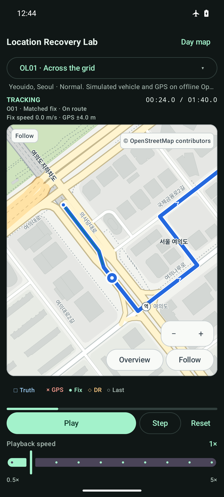
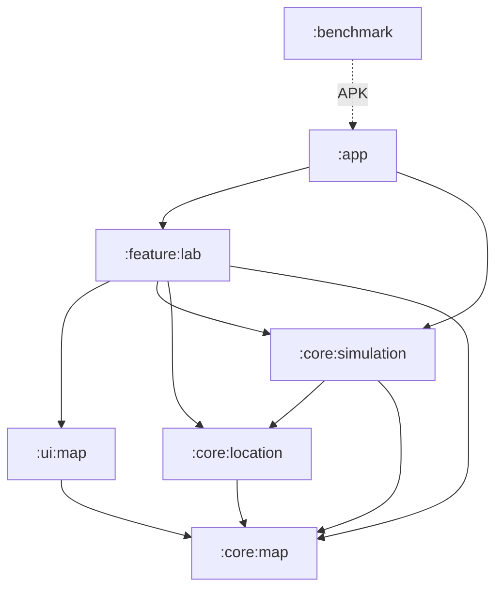

# Location Recovery Lab

오프라인 OpenStreetMap 도로에서 가상 GPS 위치 점프, 신호 손실, 제한적 Dead Reckoning(DR), 재획득과 경로 이탈을 관찰하는 세로 전용 Android 실험 앱이다. 대한민국 OSM에서 추출한 10개 지역과 18개의 가상 장시간 주행을 제공한다. 기존 합성 지도와 회귀 시나리오도 선택할 수 있다.



## 대표 주행

기본 **ODEMO_LONG**은 서울 성수동의 실제 도로 위에서 가상 180초 동안 위치 점프, 신호 손실과 재획득, 계획 경로 이탈 및 복귀를 보여준다. **OL01–OL17**은 90–120초 주행이며, 터널 내부의 짧고 긴 손실은 **OL06·OL07**에서 재현한다. 기존 **DEMO_LONG**, **L01–L17**, **DEMO**, **S01–S17**은 합성 주행 그룹에서 찾을 수 있다.

재생·일시정지, 한 단계씩 실행, 초기화와 0.5×–5× 배속을 지원한다. 지도에서 차량 추적과 전체 경로를 전환하거나 확대·이동할 수 있다. 주간·야간 지도, 합성 실제 위치 표시, 판정 로그와 평가 결과는 주행 화면에서 확인한다. [국내 OSM 지역과 재현 방법](docs/osm-data-pipeline.md) · [지도 렌더링 설계](docs/korea-map-design.md) · [에뮬레이터 성능 비교](docs/korea-map-performance.md) · [실행 화면](docs/osm-visual-verification.md)

## 빌드와 검증

JDK 17, Android SDK 36 및 Android SDK command-line tools가 필요하다. 최소 실행 API는 26이다. SDK 위치는 `ANDROID_HOME` 또는 Android Studio로 설정한다.

```bash
./gradlew :app:assembleDebug
adb install -r app/build/outputs/apk/debug/app-debug.apk
adb shell am start -n lab.recovery.app/.MainActivity

./gradlew verifyModuleBoundaries :core:map:test :core:location:test :core:simulation:test \
  :feature:lab:testDebugUnitTest :ui:map:testDebugUnitTest :app:testDebugUnitTest
./gradlew :feature:lab:lintDebug :ui:map:lintDebug :app:lintDebug \
  :app:assembleRelease :app:assembleDebugAndroidTest :benchmark:assembleBenchmark
./gradlew :app:connectedDebugAndroidTest \
  -Pandroid.testInstrumentationRunnerArguments.class=lab.recovery.app.RecoveryInstrumentedTest

python3 -B tools/extended/generate.py
python3 -B tools/extended/check_terrain.py
python3 -B tools/osm/verify.py
./gradlew :core:simulation:run --args='fixtures/osm build/reports/osm-evaluation.json build/reports/osm-evaluation.md'
./gradlew :core:simulation:run --args='fixtures/evaluation build/reports/legacy.json build/reports/legacy.md'
./gradlew :core:simulation:run --args='fixtures/extended build/reports/extended.json build/reports/extended.md'
```

오프라인 1× 내구 및 Macrobenchmark는 별도 대상이다. [계측 방법과 환경](docs/physical-device-validation.md)

## 구성



Android와 JVM은 동일한 fixture와 파서를 사용한다. 엔진은 가상 관측·Tick·도로 연결·계획 경로를 사용하며, 기대값과 실제 가상 위치는 평가와 표시에서만 쓰인다. 정적 지도 형상은 월드 좌표로 캐시되고, 지도 카메라는 재생과 별도 상태로 동작한다. [아키텍처](docs/architecture.md) · [알고리즘](docs/algorithm.md)

## 결과

- [기존 S 계열 평가](docs/evaluation-report.md) · [장시간 및 독립 평가](docs/extended-evaluation-report.md)
- [OSM 기반 독립 평가](docs/osm-evaluation-report.md) · [OpenStreetMap 데이터 라이선스](data/osm/README.md)
- [단위·계측·빌드·오프라인 검증](docs/verification.md) · [기기와 측정 환경](docs/physical-device-validation.md)

위치 오차와 복구 지연은 실제 지도 형상 위에서 가상 관측을 재생해 얻은 값이다. 실제 환경의 위치 정확도나 내비게이션 성능을 추정하는 데에는 별도의 실측이 필요하다.
