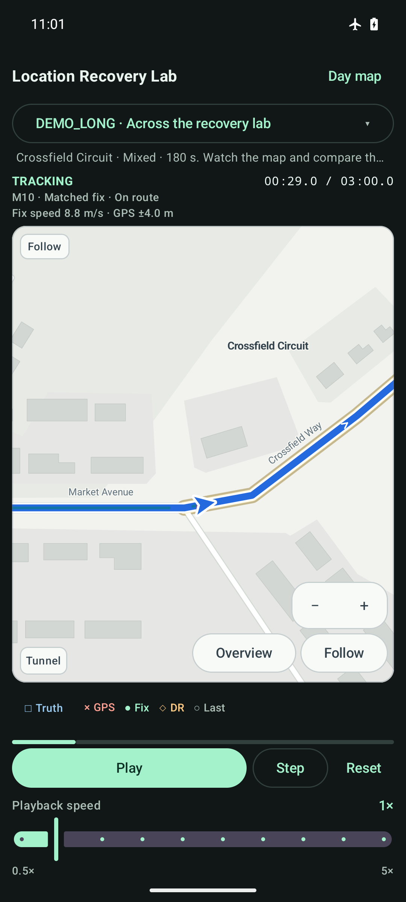
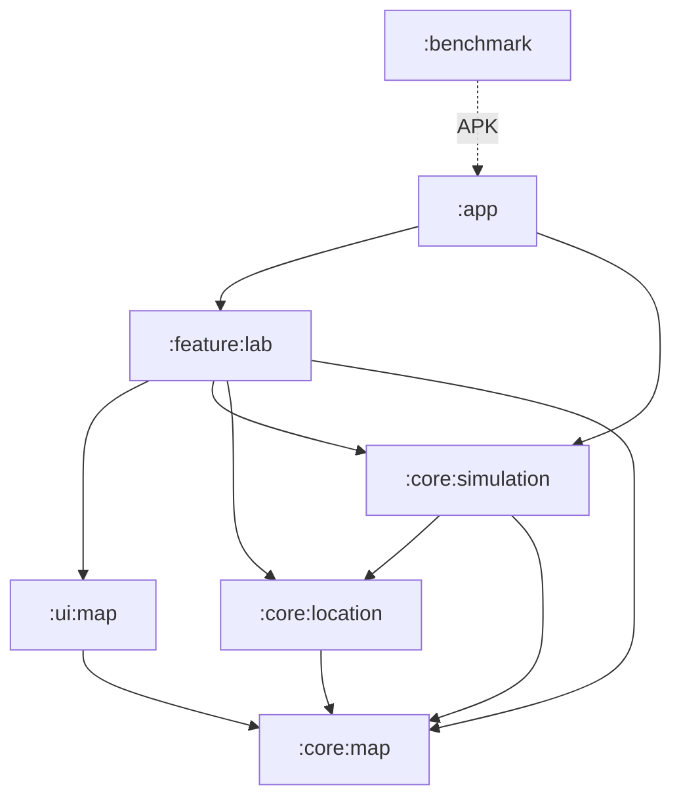

# Location Recovery Lab

합성 도로에서 GPS 위치 점프, 신호 손실, 제한적 Dead Reckoning(DR), 재획득, 경로 이탈을 관찰하는 세로 전용 Android 실험 앱이다. 10개의 합성 지도와 18개의 장시간 주행을 제공하며, 앱 실행에는 인터넷과 위치 권한이 필요 없다.



## 대표 주행

기본 **DEMO_LONG**은 180초에 걸쳐 도심 회전과 위치 점프, 고속화도로 진입, 터널 신호 손실과 DR 중단, GPS 재획득, 실제 분기 이탈과 복귀를 보여준다. **L01–L17**은 각 장애를 90–120초 주행으로 살펴볼 수 있다. 기존 **DEMO**와 **S01–S17**은 선택 목록의 빠른 회귀 그룹에 있다.

재생·일시정지, 한 단계씩 실행, 초기화와 0.5×–5× 배속을 지원한다. 지도에서 차량 추적과 전체 경로를 전환하거나 확대·이동할 수 있다. 주간·야간 지도, 합성 실제 위치 표시, 판정 로그와 평가 결과는 주행 화면에서 확인한다. [지도·시나리오 목록](docs/map-and-scenarios.md) · [지도 디자인과 실행 화면](docs/map-visual-verification.md)

## 빌드와 검증

JDK 17, Android SDK 36 및 Android SDK command-line tools가 필요하다. 최소 실행 API는 26이다. SDK 위치는 `ANDROID_HOME` 또는 Android Studio로 설정한다.

```bash
./gradlew :app:assembleDebug
adb install -r app/build/outputs/apk/debug/app-debug.apk
adb shell am start -n lab.recovery.app/.MainActivity

./gradlew verifyModuleBoundaries :core:map:test :core:location:test :core:simulation:test \
  :feature:lab:testDebugUnitTest :ui:map:testDebugUnitTest :app:testDebugUnitTest
./gradlew :feature:lab:lintDebug :ui:map:lintDebug :app:lintDebug \
  :app:assembleRelease :app:assembleDebugAndroidTest :benchmark:assembleBenchmark
./gradlew :app:connectedDebugAndroidTest \
  -Pandroid.testInstrumentationRunnerArguments.class=lab.recovery.app.RecoveryInstrumentedTest

python3 -B tools/extended/generate.py
python3 -B tools/extended/check_terrain.py
./gradlew :core:simulation:run --args='fixtures/evaluation build/reports/legacy.json build/reports/legacy.md'
./gradlew :core:simulation:run --args='fixtures/extended build/reports/extended.json build/reports/extended.md'
```

오프라인 1× 내구 및 Macrobenchmark는 별도 대상이다. [계측 방법과 환경](docs/physical-device-validation.md)

## 구성



Android와 JVM은 동일한 fixture와 파서를 사용한다. 엔진은 합성 관측·Tick·도로 연결·계획 경로를 사용하며, 기대값과 실제 가상 위치는 평가와 표시에서만 쓰인다. 정적 지도 형상은 월드 좌표로 캐시되고, 지도 카메라는 재생과 별도 상태로 동작한다. [아키텍처](docs/architecture.md) · [알고리즘](docs/algorithm.md)

## 결과

- [기존 S 계열 평가](docs/evaluation-report.md) · [장시간 및 독립 평가](docs/extended-evaluation-report.md)
- [단위·계측·빌드·오프라인 검증](docs/verification.md) · [기기와 측정 환경](docs/physical-device-validation.md)

위치 오차와 복구 지연은 합성 직교 좌표에서 얻은 값이다. 실제 환경의 위치 정확도나 내비게이션 성능을 추정하는 데에는 별도의 실측이 필요하다.
