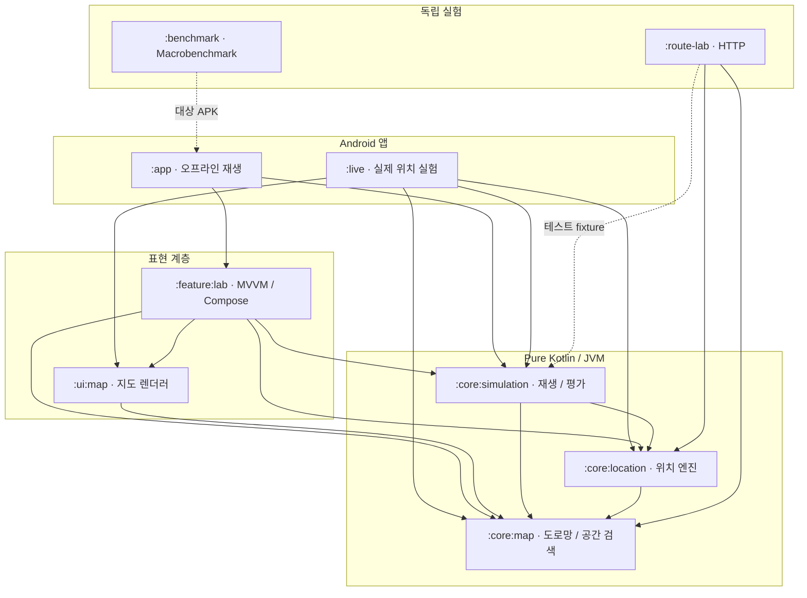
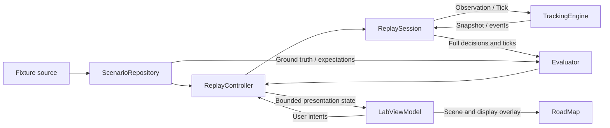
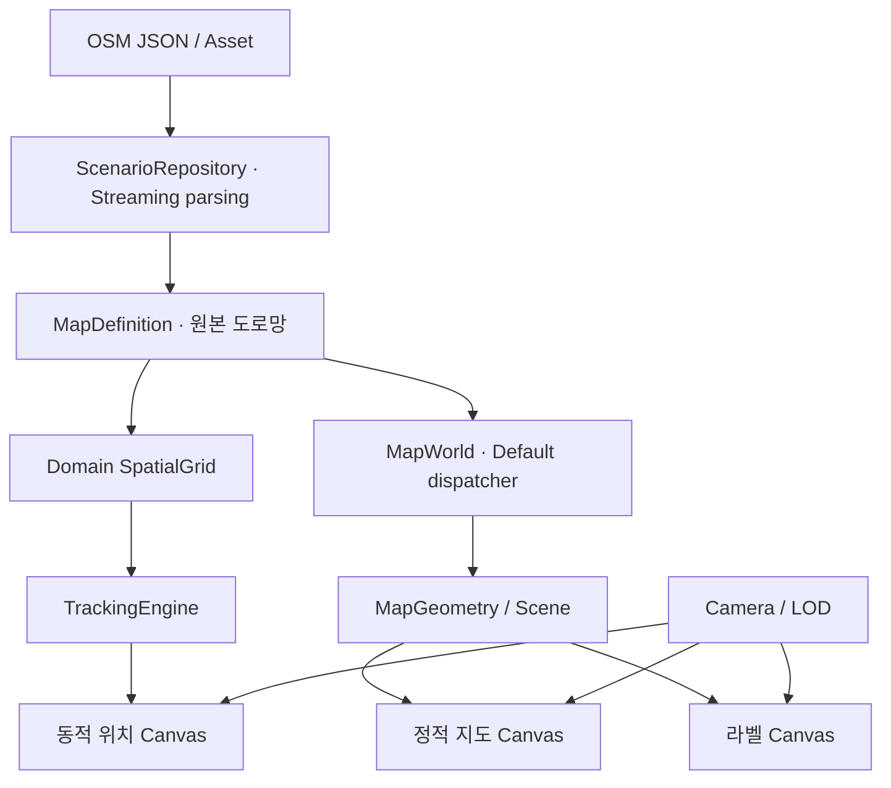
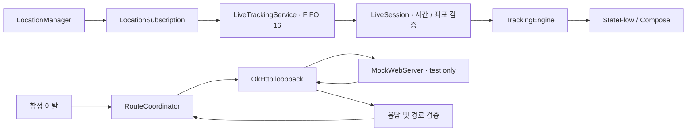

# 시스템 아키텍처

[README](../README.md) · [위치 알고리즘](algorithm.md) · [지도 렌더링](korea-map-design.md) · [Live 위치](live-location.md) · [HTTP 실험](network-reliability.md)

## 설계 의사결정

| 기술적 과제 | 선택한 구조 | 효과 및 확인 방법 |
|---|---|---|
| 위치 처리와 Android UI의 결합 | 순수 Kotlin 코어 / Compose 표현 계층 / Android 위치 어댑터 | JVM에서 결정적 위치 평가와 모듈 의존성 검사 |
| 빠른 지도 전환과 재생 취소 | 단일 명령 큐, 실행 ID 및 generation, 작업 Dispatcher | 늦은 결과 차단, Reset·Activity 재생성 계측 |
| 대형 도로망의 처리 비용 | 원본 도로와 표현 데이터를 분리하고 Spatial Grid·LOD·가시 Path 캐시 사용 | 매칭 판정 동등성, Macrobenchmark와 Perfetto |
| 오프라인·실제 GPS·HTTP 실험의 격리 | 앱 2개와 독립 JVM HTTP 모듈 | 권한·APK·fixture 검사 및 실제 리스너 해제 |

[성능 비교](refactor-performance.md) · [플랫폼 검증](verification.md) · [전체 문서 안내](index.md)

## 전체 9개 모듈

실선은 Gradle 선언 의존성, 점선은 테스트 경계다. 기본 앱과 Live는 별도 APK이며 HTTP 실험은 독립 JVM 모듈이다.

## 설계 경계

| 계층 | 책임 |
|---|---|
| App / Live / HTTP | 권한 없는 재생, 실제 위치 추적, 로컬 HTTP 격리 |
| Core Map / Location | 원본 도로망과 순수 Kotlin 공간 검색·위치 판정 |
| Simulation / Evaluator | 관측·Tick은 엔진, Ground Truth와 기대값은 평가기 |
| Feature / Map UI | 재생 상태와 독립 카메라·렌더링 |
| Benchmark | 대상 APK와 성능 계측 분리 |

`verifyModuleBoundaries`는 Gradle 구성에서 기존 7개 모듈과 Live·HTTP 실험을 포함한 총 9개 모듈의 선언 의존성을 검사한다. Android 테스트의 도메인 타입과 Macrobenchmark의 대상 APK는 테스트 경계로 다룬다. 세 코어 모듈은 JVM에서 독립 실행된다.

## 재생·평가 데이터 흐름

## 결정적 재생과 취소

- 앱은 asset 어댑터를 주입한다. JVM CLI에는 파일 어댑터를 주입한다. 두 환경에서 원본 JSON과 검증 로직을 공유한다.
- `ReplaySession`이 가상 시각별 관측·Tick·종료를 결정적으로 처리한다. 모든 이벤트는 바로 평가기에 기록된다. `ReplayController`는 단일 명령 큐와 현재 실행 ID로 데이터 로딩, 엔진, 완료 결과를 조율한다. 무거운 단계에는 IO·작업 Dispatcher를 사용한다.
- 재생 deadline은 단조 시계와 하나의 가상 시간 기준점에서 계산한다. Pause는 가상 진행량을 동결하고 배속 변경은 변경 시각까지 진행된 양을 반영한다. 지연 발생 시 최대 12개 가상 시각을 한 차례 처리한 뒤 다음 명령을 받을 수 있다. 256칸 입력 큐가 가득 차면 화면에 재시도 상태를 표시한다.
- 화면 로그는 500건, 표시 이력은 출처별 1,000개다. 이력은 추정 시작·중단, 위치 거부·재정합, 출처 변경에서 끊긴다. 세션 전환은 이전 timer generation과 실행 ID를 무효화한다. 세로 Activity 재생성은 같은 ViewModel을 사용하고, 제거 시 컨트롤러 scope를 취소한다. 기존 백그라운드 동작에 따라 ViewModel 생존 동안 재생을 이어간다.
- `DriveHud`는 엔진 snapshot과 `ReplaySession`에 전달된 동일 설정으로 Fix 경과, 활성 DR 상한과 재획득 분모를 읽는다. 주요 판정 요약은 현재 실행의 제한된 로그에서 한 건을 선택한다. `RunResults`는 완료한 실행의 `Evaluation` 분모와 paired 오차를 사용한다. 지도 마커와 범례는 `ui:map`의 `MapSymbol` 색상을 공유한다. [표시와 검증 근거](recovery-ui-validation.md)
- 배속 대화상자의 슬라이더와 5× 바로 선택은 같은 `PlaybackSpeeds` 범위와 `UiIntent.Speed`를 사용한다. 범례 창은 현재 지도 테마를 읽고 Truth 토글은 기존 세션 화면 상태를 사용한다. [실행과 조작](demo.md#ol07-시연)

## 지도

`MapDefinition`은 방향성 네트워크와 UI 표현 데이터를 가진다. `RoutePlan`은 시나리오마다 연결하며 같은 지도에 서로 다른 계획을 붙일 수 있다. 엔진은 노드 ID와 허용 전이 및 시나리오 계획 경로를 사용한다. 건물·수변·라벨과 기대 판정은 엔진 입력에 포함되지 않는다.

`ui:map`은 지형·도로·경로 Path를 활성 장면 한 개에 대해 월드 좌표로 준비한다. 차량 데이터가 갱신되면 카메라 행렬로 경로와 지형을 투영하고 동적 오버레이를 그린다. Follow는 채택·추정·마지막 확인 위치를 사용한다. Overview는 계획 경로 bounds에 맞추고 수동 pan·zoom은 Free 모드로 전환한다. 이 상태는 지도 Composable이 소유한다. 카메라 조작과 지도 색상 변경은 재생 명령을 보내지 않는다.

`benchmark`는 Release 상속 변형의 별도 패키지 `lab.recovery.app.benchmark`를 대상으로 한다. 현재 OSM 성능 검증의 `RefactorMapBenchmark`는 O10 콜드 기동, O10→O07→O10 전환 및 O10 1× 주행·카메라 조작을 측정한다. 기존 합성 지도 벤치마크 결과는 [실기기 측정 이력](physical-device-validation.md)에 분리해 보존한다.

## 합성 지도 표현 개정 이력

지도 v2 표현 개정은 방향을 지정한 필지·건물, 구역 등급, 수변·녹지, 산책로와 이름을 읽는다. 기존 도로·경로·전이 식별자의 해시를 검사하고 시나리오 원본을 공유한다. `MapGeometry`가 월드 Path와 bounds를 준비하고, `MapLayers`가 가시 영역에 해당하는 지형·제어된 도로 레이어·경로와 오버레이를 그린다. `MapLabels`는 화면 좌표에서 라벨 방향·경계·우선순위를 계산한다. [지도 디자인](map-design.md)

## OSM 오프라인 데이터셋

`ScenarioRepository`는 합성 v2와 OSM v3 카탈로그를 별도로 읽는다. OSM 기본 데모는 OSM 카탈로그의 representative 항목에서 선택한다. OSM 지도는 출처·투영·원점·표시 경계와 시나리오에 고정된 SHA-256을 보유한다. 개발용 PBF 변환은 일반 빌드와 Android에서 실행하지 않는다.

`ui:map`은 맵 모듈로 전달된 실제 좌표, 내곽이 있는 다각형, 방향별 에지의 물리 도로 ID, 로딩된 지도 경계를 사용한다. 화면 밖 world Path는 그리기에서 제외하며 한 장면의 Path는 가시화될 때 만들어 재사용한다. 출처 버튼은 지도 카메라와 별도 좌표로 배치한다. [OSM 데이터 파이프라인](osm-data-pipeline.md)

국내 지도 확장에서는 표현용 도형에 철도·공공 시설·POI와 축척별 도형을 추가했다. 동일 폴리라인을 공유하되, 화면 인덱스와 단순화가 도로 매칭이나 가상 주행에 영향을 주지 않는다. [국내 상세 지도 설계](korea-map-design.md)

## 비동기 지도 준비와 렌더링 최적화

앱의 asset 읽기와 JSON 변환은 IO Dispatcher에서 수행하고 저장소는 최근에 읽은 canonical 지도 한 개를 유지한다. 지도 타일이 아닌 월드 Bounds와 물리 도로 중복 제거, 레이어와 인덱스 준비는 `Dispatchers.Default`에서 수행한다. 화면은 현재 `MapScene`을 확인하고 이전 작업 결과의 반영을 막는다. 지도 준비 취소 시 체크포인트에서 작업을 종료한다. 정적 월드에는 checksum과 스타일의 인덱스 사용 여부를 기준으로 한 슬롯을 사용하며, 계획 경로와 실행 ID는 별도로 보유한다. `Path`는 실제 그리는 UI 스레드에서 지연 구성한다.

정적 지도, 위치·이력, 라벨 Canvas를 분리한다. 뷰포트가 같다거나 확대 수준이 유지되는 동안 라벨 이름·글꼴 측정과 우선순위 순서는 캐시한다. 카메라 이동 시 월드 후보 범위를 재사용하고 투영은 현재 카메라로 수행한다. 위치와 조작 영역에 따른 충돌은 현재 값으로 검사한다.

`core:map`의 월드 셀 검색은 지도 표시와 위치 검색이 공유한다. 위치 엔진은 원본 도로의 Bounds만 인덱스에 등록한다. UI Path, 라벨 또는 표현용 단순화가 위치 매칭 계층으로 들어가지 않는다. [성능 전후 측정](refactor-performance.md)

## 플랫폼 신뢰성 모듈

기존 앱과 벤치마크 package·APK 작업을 유지한다. `:live`는 `LocationManager → 서비스 대기열 → Live 바인딩 → TrackingEngine` 순서로 처리하며 UI는 불변 상태를 관찰한다. 계획 없이 지도를 표시하는 경우 경로 그래픽과 판정을 생략한다. `:route-lab`의 합성 엔진 및 HTTP 코드는 두 APK의 클래스패스에 포함되지 않는다. `:core`와 `:ui:map`은 Android 위치 서비스 및 HTTP 구현에 의존하지 않는다.

[Live 위치 정책](live-location.md) · [HTTP 상태와 장애 검증](network-reliability.md) · [APK 검사와 수용 게이트](verification.md)

## 지도 데이터 흐름

[렌더링 상세](korea-map-design.md) · [저메모리 fallback](stability-investigation.md)

## 독립 실행 흐름

두 흐름은 독립적이며 실제 위치는 HTTP 실험으로 전송되지 않는다. [Live 정책](live-location.md) · [네트워크 설계](network-reliability.md)
