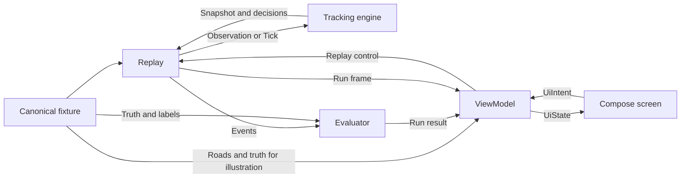

# 아키텍처

- `:core:location`은 도로·관측 타입, 위치 검증, Map Matching, 추정, 신호·경로 상태를 순수 Kotlin/JVM으로 구현한다. 엔진은 한 시각의 입력만 받고 평가 정답에 대한 의존성이 없다.
- `:core:simulation`은 공용 JSON 원본 검증, 가상 시계, 관측·Tick 정렬, 평가, JVM CLI를 제공한다. 재생 세션은 소유자 하나가 순서대로 진행하며 배속은 외부 대기 시간에만 영향을 준다.
- `:app`의 ViewModel은 로더와 작업 Dispatcher를 주입받아 명령을 직렬화하고 읽기 전용 StateFlow를 발행한다. 파일 읽기는 IO Dispatcher, 엔진과 평가 계산은 작업 Dispatcher에서 실행한다. Compose는 현재 화면 상태에서 Canvas와 UI를 렌더링한다.
- 세로 화면 재생성은 동일 ViewModel과 실행 ID를 유지한다. Reset·시나리오 변경·종료는 먼저 활성 ID를 무효화하고 관련 작업을 취소한다. 각 상태 반영은 현재 세션 ID를 확인한다. 로그는 500건, 위치 이력은 출처별 1,000개 표본으로 제한한다.
- Android asset은 Gradle이 루트의 `fixtures/`에서 패키징한다. JVM은 같은 파일과 파서로 실행한다. 체크섬·스키마 버전·평가 설정은 평가 JSON에 남는다.

의존성은 `:app → :core:simulation → :core:location` 및 화면의 도메인 타입 사용을 위한 `:app → :core:location`이다.

`:benchmark`는 앱 외부에서 동작하는 Macrobenchmark 계측 모듈이다. 측정 대상 `:app`의 `benchmark` 변형은 Release 구성을 상속하고 별도 앱 ID로 설치된다. `profileable`과 ProfileInstaller는 이 변형에만 적용한다.
