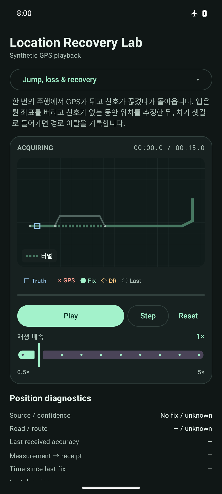
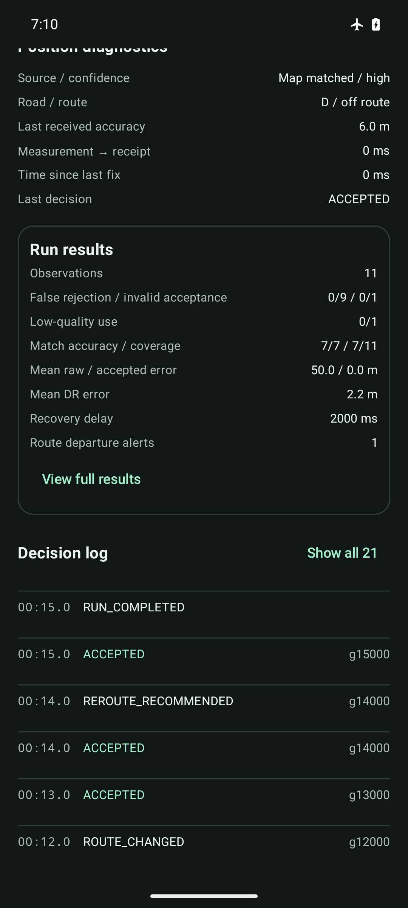

# Android 데모

API 36 ARM64 에뮬레이터에서 기본 데모를 실행했다. 이 앱의 fixture는 내장 Android asset이며 네트워크가 없는 상태에서 실행할 수 있다.

1. 앱을 열고 기본 **Jump, loss & recovery** 시나리오를 선택한다. 선택 목록 아래에서 상황과 확인할 결과를 읽을 수 있다. 지도 왼쪽 아래의 점선 범례로 터널 구간을 확인할 수 있다.
2. 가로 슬라이더로 0.5×~5× 배속을 고르고 **Play**를 누른다. 3초에는 위치 점프가 거부되고 5초에는 신호 손실과 DR 시작을 확인할 수 있다.
3. 7초의 저품질 관측은 위치를 갱신하지 않는다. 분기에 도달하면 추정이 중단되고 마지막 확인 위치가 표시된다.
4. 12초에 신호가 복구되고, 14초에 실제 분기 이탈 권고가 한 번 나온다.
5. 완료 후 **Run results**와 **Decision log**를 확인한다. **Step**은 다음 가상 시각의 관측과 Tick을 한 번에 처리한다.




같은 기본 데모를 JVM에서 실행할 수 있다.

```bash
./gradlew :core:simulation:run --args='fixtures/development/DEMO.json'
```
