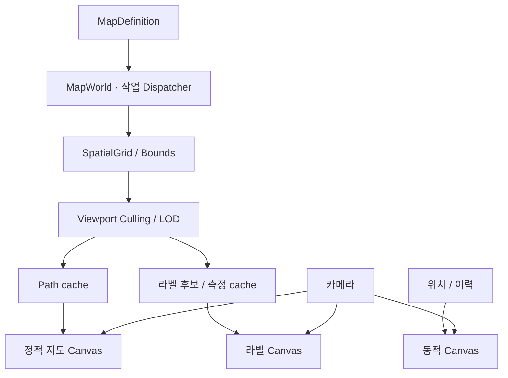

# 국내 OSM 지도 렌더링 설계

[README](../README.md) · [아키텍처](architecture.md) · [데이터](osm-data-pipeline.md) · [화면](osm-visual-verification.md)

## 설계 요약

| 설계 선택 | 목적 |
|---|---|
| 원본 도로망과 표시용 geometry 분리 | 화면 단순화가 위치 판정에 영향을 주지 않도록 함 |
| 월드 인덱스·Viewport Culling·LOD | 화면 밖 도형과 축척별 불필요한 세부 형상 제외 |
| 정적·동적·라벨 Canvas 및 캐시 | 위치 갱신과 지도 준비의 책임 분리, 기존 도형 재사용 |
| 저메모리 Software Canvas | API 26·48MiB 환경에서 정적 지도 viewport bitmap 재사용 |

[성능 전후 측정](refactor-performance.md) · [실기기 후보 검증](rendering-memory-rca.md)

실제 도로·건물·수역·POI를 Compose Canvas로 표시하되 화면 표현과 원본 위치 매칭 형상을 분리합니다.

| 확대 단계 | 표현 정책 |
|---|---|
| Detail | 개별 건물, 상세 도로 및 시설 |
| Mid | 중간 단순화, 주요 시설과 도로 |
| Overview | 전체 경로, 주요 도로 및 축소 형상 |

Android 8·48MiB 이하 앱 힙 조건에서는 정적 지도에 Software Canvas와 단일 viewport bitmap을 사용합니다. [장애 분석](stability-investigation.md)

대한민국 Geofabrik 추출본에서 10개 지역을 가공합니다. 각 지역은 기존 시나리오의 환경을 유지하기 위해 다른 도로망을 사용합니다. 기본 오프라인 앱과 JVM 평가는 같은 OSM v3 데이터와 가상 주행을 읽으며 실제 차량 위치를 수집하지 않습니다. 별도 Live 앱은 동일 지도 표현 모듈을 사용합니다.

## 표시 레이어

- 도로 중심선의 노드·방향·레벨과 별개로 건물 exterior/inner ring, 주거·상업·학교·운동장·공원·수역·주차장 영역을 제공합니다.
- 철도는 지상 선로의 표현 레이어, 지하철역·철도역·학교·공원·운동장·주차장·주유소는 원본 태그로 확인된 POI입니다. 도로명과 시설명은 `name:ko`를 우선합니다. 공공 시설명은 표시하며 주유소와 주차장은 기호만 표시합니다.
- 도로 매칭은 원본 중심선을 사용합니다. 렌더러는 Detail, Mid, Overview의 세 단계에서 건물·시설·도로를 선택합니다. Mid와 Overview에서는 표현용 선을 각각 1m·3m 허용 오차로 단순화합니다. 토지 영역의 중·원거리 형상은 2m·7m 단순화로 가공하며 유효성과 내부 링을 확인합니다.
- 월드 좌표 192m 셀 인덱스가 도로·구역·보행로·철도·POI의 화면 밖 후보를 제외합니다. 여러 셀에 걸친 항목은 원래 레이어 순서에서 한 번만 선택합니다. 선택된 장면의 가시 Path는 단계별로 지연 생성해 캐시합니다.
- 정적 지도 Canvas와 위치·이력 Canvas를 분리했습니다. Follow에서 채택 차량 중심이 이동할 때 정적 지도는 기존 월드 Path를 새 카메라로 그립니다. 원시 GPS나 이력 갱신 자체는 정적 지도 입력에 포함되지 않습니다. 라벨은 차량·조작부·출처 영역을 피하고 시설 종류와 도로 등급에 따라 우선순위를 지정합니다.

[OSM 자료와 라이선스](../data/osm/README.md)

P17–P24에서는 정적 월드 준비를 백그라운드로 옮기고 동일 지도에서 계획 경로만 바뀔 때 월드 인덱스·도형을 재사용합니다. 카메라 이동으로 라벨의 화면 위치가 달라지면 다시 투영합니다. 주변 후보의 캐시 범위에 들어오는 동안 셀 검색 결과를 재사용하고, 글꼴 측정 캐시 상한은 256개입니다. 화면에 맞춘 우선순위와 POI·한글 도로명 노출은 유지합니다. [성능 비교](refactor-performance.md)

같은 주행에서 차량 추적으로 돌아올 때 마지막 수동 확대·축소 배율을 유지합니다. 전체 경로 보기는 전체 경로에 맞는 배율을 사용하고 마지막 수동 배율을 보존합니다. 지도 선택이나 주행 초기화 시 기본 배율에서 시작합니다.
