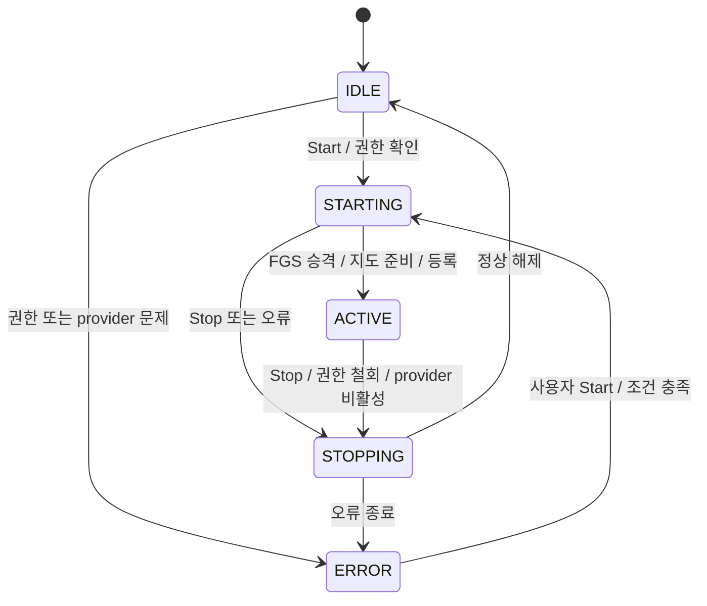

# Android Live 위치 추적과 Foreground Service

[README](../README.md) · [아키텍처](architecture.md) · [장애 조사](stability-investigation.md)

## 설계 요약

별도 APK에서 Android 위치 권한, Foreground Service의 생명주기, 화면 꺼짐·Activity 재생성·권한 철회 시 세션 안전성을 검증합니다.



Home·화면 잠금·Activity 재생성 중 서비스가 세션을 유지합니다. 시스템 종료 후 자동 재시작하지 않고 다음 실행에서 중단을 알립니다.

**검증한 기능:** API 26·31·33·34·36 에뮬레이터에서 위치 권한과 서비스 생명주기를 계측했습니다. 2026-11-27 SM-G975N의 `ce617de`에서 Live 시작·종료 20회와 마지막 Stop 뒤 서비스·활성 리스너 해제를 확인했습니다. [실기기 자원 해제](recovery-ui-physical-g8.md#지도-전환재생과-live-해제) · [권한별 동작](#android-권한과-세션).

## 실행 방법

`:live`는 기존 합성 재생 앱과 별도로 설치합니다. 앱에서 국내 OSM 지도를 고른 뒤 Start를 눌러 주세요. Android가 위치 권한을 묻는 경우 선택을 마친 뒤 다시 Start를 눌러 주세요. 계획 경로 선택은 선택 사항이며 지정하지 않으면 원시 위치 진단만 제공합니다. 지도 밖, 투영 검증 실패, 낮은 위치 품질, 대략적 권한은 화면에 각각 표시합니다. 대략적 권한에서는 원시 진단만 제공합니다.

**LIVE LOCATION** 화면에서 Start와 Stop 아래에 세션 상태, 권한 수준과 현재 fix 상태를 묶어 표시합니다. 위치가 수신되면 제공자, Android 모의·에뮬레이터 구분, 마지막 수신 정확도 및 수신·처리·드롭 건수를 확인할 수 있습니다. [Live UI 검증](recovery-ui-validation.md#phase-7--live-화면)

```bash
./gradlew :live:assembleDebug :live:assembleRelease :live:assembleDebugAndroidTest
adb install -r live/build/outputs/apk/debug/live-debug.apk
./gradlew :live:testDebugUnitTest
tools/run_live_instrumentation.sh
```

## Android 권한과 세션

| 조건 | 동작 |
|---|---|
| API 26+ | 전경에 보이고 포커스를 가진 Activity의 Start를 통해서만 위치 포그라운드 서비스를 시작합니다. 서비스는 알림을 게시한 후 지도 파일을 읽습니다. |
| 정밀 권한 | GPS provider를 등록합니다. 약 1초 간격을 요청하며 실제 주기는 OS와 provider가 정합니다. |
| 대략적 권한 | 네트워크 또는 해당 API에서 지원하는 fused provider가 활성일 때 원시 신호만 받습니다. |
| API 31+ | 정밀·대략 선택을 허용하며 권한 변경이나 백그라운드 서비스 시작 거절을 오류 상태로 처리합니다. |
| API 33+ | 알림 권한을 별도 버튼으로 요청합니다. 알림 권한을 거부해도 위치 권한과 전경 시작 조건이 충족되면 서비스를 시작하며 앱에서 Stop을 사용할 수 있습니다. |
| API 34+ | 비공개 서비스에 `location` 타입과 서비스 타입 권한을 선언합니다. 시작 시점의 while-in-use 요건을 Android가 재확인합니다. |
| Stop·권한 변경·provider 비활성 | 등록과 대기열, 세션 작업 및 알림을 해제합니다. 시작 조건이 복구되면 사용자 동작으로 새 세션을 열 수 있습니다. |
| Home·화면 잠금·Activity 재생성 | 실행 중인 서비스가 세션을 계속 소유합니다. Activity는 생명주기에 맞춰 같은 세션을 관찰합니다. |
| 시스템에 의한 종료·재부팅 | `START_NOT_STICKY`를 사용합니다. 이전 시작 표시가 남아 있으면 다음 실행에 중단을 표시합니다. 새로운 Start, 권한 확인 및 신선한 위치로 다시 시작합니다. |

앱은 백그라운드 위치와 인터넷 권한을 선언하지 않습니다. 현재 위치와 엔진 상태는 세션 메모리에만 유지합니다. 종료 후 중단을 알리는 불리언 한 개만 앱 내부 저장소에 기록하며 백업은 비활성화합니다. 알림과 운영 로그에는 좌표가 없고 Live 화면은 Android 화면 캡처를 제한합니다. 실기기 계측은 GPS 수신 여부와 서비스 시작·종료를 확인하며 좌표를 기록하지 않습니다.

## 수신·시간·좌표

Android Looper에서 콜백을 받고 16개 FIFO 대기열에 넣습니다. 초과 시 새로운 fix를 버리고 드롭 횟수를 올립니다. 한 코루틴이 Observation과 Tick을 직렬로 적용하며 projection과 엔진 처리는 작업 디스패처에서 수행합니다. Tick은 약 200ms 간격으로 공급하고 미실행 구간을 일괄 재생하지 않습니다. 등록·대기열·세션 토큰은 Stop에서 닫힙니다.

`Location.elapsedRealtimeNanos`와 `SystemClock.elapsedRealtimeNanos()`에서 각각 측정과 수신 시간을 읽고 세션 기준으로 ms를 계산합니다. 세션 이전, 미래, 수신 지연 3초 초과, 같은 ms 또는 역순 fix는 엔진에 전달하지 않습니다. accuracy가 누락되거나 현재 엔진의 정밀 기준 20m를 넘으면 원시 진단을 유지합니다. speed·bearing은 누락 상태를 보존합니다. Android mock 플래그와 에뮬레이터 환경을 표시하며 mock 출처가 바뀌면 엔진 이력을 새로 시작합니다.

WGS84 입력은 경도·위도 순서로 EPSG:5179 Transverse Mercator에 투영한 뒤 지도별 원점을 뺍니다. 지도 렌더러가 화면 Y축만 반전합니다. 지도 체크섬과 경계 네 점·중심·도로점에서 0.5m 허용 오차를 검사합니다. 지도 이탈과 품질 저하 시 엔진 및 DR 상태를 지우며, 재진입은 같은 선택 경로를 사용한 새 엔진 epoch에서 시작합니다. 검증 자료는 기존 OSM 공개 좌표에서 유도했으며 `tools/osm/live_projection_samples.py`로 재생성할 수 있습니다.

Release에는 OSM 지도·출처·카탈로그·투영 기준점과 기존 경로에서 추출한 6개 필드만 패키징합니다. Live 코드가 합성 관측이나 Ground Truth를 읽을 경로를 제공하지 않습니다.

## 실기기 시험 이력

2026-11-27 SM-G975N에서 기준 A와 UI 후보 `ce617de`가 각각 G8 Live 시작·종료 20회를 통과했다. 마지막 Stop 뒤 FGS와 활성 리스너는 각각 0개였고 임시 위치 권한을 회수했다. G9에서는 두 빌드에서 Live와 직접 GPS 요청을 대조했으며 fresh fix는 없었다. 대기 UI와 실행한 시험의 해제를 확인했고 보안 잠금이 필요한 후속 수명 검증은 BLOCKED다. 과거 `d0b3822`의 실제 GPS 수신과 G9의 이번 무수신은 각 시험의 기록으로 보존한다. [G8 Live 검증](recovery-ui-physical-g8.md#지도-전환재생과-live-해제) · [G9 현재 GPS 검증](recovery-ui-physical-g9.md) · [과거 실기기 GPS](real-device-final-validation.md)

## 기술 근거

2026-11-25에 API 동작과 투영 방식의 기준으로 확인했다.

- 위치 측정·등록과 mock 판별. [Location](https://developer.android.com/reference/android/location/Location) · [LocationManager](https://developer.android.com/reference/android/location/LocationManager)
- FGS 유형과 시작 제약, 알림 권한, 시스템의 사용자 정지. [서비스 유형](https://developer.android.com/develop/background-work/services/fgs/service-types) · [시작 제한](https://developer.android.com/develop/background-work/services/fgs/restrictions-bg-start) · [알림 권한](https://developer.android.com/develop/ui/compose/notifications/notification-permission) · [사용자 정지](https://developer.android.com/develop/background-work/services/fgs/handle-user-stopping)
- 한국 통합 좌표계와 투영. [EPSG:5179](https://epsg.org/crs_5179/KGD2002-Unified-CS.html) · [PROJ Transverse Mercator](https://proj.org/en/stable/operations/projections/tmerc.html)

[검증 결과](verification.md) · [장애 조사](stability-investigation.md)
