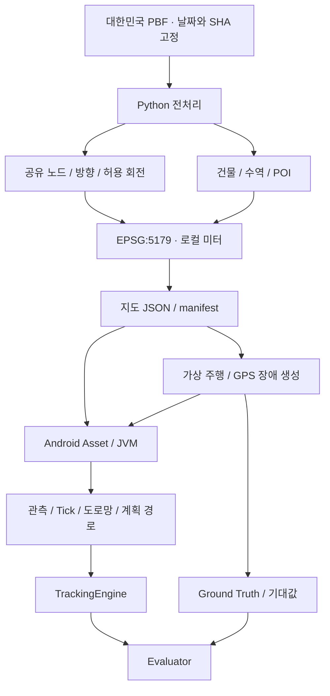

# OpenStreetMap 데이터 가공 및 재현

[README](../README.md) · [지도 설계](korea-map-design.md) · [화면](osm-visual-verification.md) · [라이선스](../data/osm/README.md)

**재현 계약:** 날짜와 해시를 고정한 OSM 원본, 지역별 좌표 변환, 가공 데이터·시나리오 체크섬을 연결합니다. Android 및 JVM은 동일한 가공본을 읽고 Ground Truth는 독립 평가에서만 사용합니다.

## 데이터 흐름



원본 다운로드와 앱 실행을 분리합니다. 일반 빌드와 CI는 가공 데이터를 사용합니다. 원본 중심선과 연결 정보는 위치 판정에, 표현용 단순화는 렌더링에 사용합니다.

OSM 데이터셋 `fixtures/osm/`은 이전 합성 지도·주행과 별도 카탈로그를 사용합니다. Android에는 같은 폴더를 asset으로 패키징하며 JVM CLI도 동일한 JSON을 읽습니다. 앱은 선택 지역 하나만 로드합니다. 지도 데이터 출처는 지도 안에 표시하고, 출처 버튼에서 스냅샷과 ODbL 라이선스 및 주소를 오프라인으로 볼 수 있습니다.

## 재현

Python 3.13에서 개발 도구 의존성을 설치합니다. `acquire`만 원본 데이터 다운로드를 수행합니다. 이후 명령은 로컬 PBF를 읽으며 일반 빌드, 앱과 CI에는 Python GIS 의존성 또는 PBF가 필요 없습니다.

```bash
python3.13 -m venv build/osm-venv
build/osm-venv/bin/pip install -r tools/osm/requirements.txt
build/osm-venv/bin/python -B tools/osm/import_maps.py acquire
build/osm-venv/bin/python -B tools/osm/import_maps.py import
build/osm-venv/bin/python -B tools/osm/generate_scenarios.py
python3 -B tools/osm/verify.py
./gradlew :core:simulation:run --args='fixtures/osm build/reports/osm.json build/reports/osm.md'
```

`--source`로 이미 확보한 PBF를 지정할 수 있습니다. 원본의 SHA-256과 PBF 헤더의 replication timestamp를 확인하며, 날짜가 이동하는 latest URL은 사용하지 않습니다. `--output`으로 변환과 주행 생성을 대체 폴더에 수행해 기존 가공본과 비교할 수 있습니다. [원본 및 변환 manifest](../fixtures/osm/manifest.json) · [데이터 라이선스](../data/osm/README.md)

## 변환 계약

1. 대한민국 PBF에서 지역별 bbox에 걸친 원본 도로 way의 노드 참조를 보존합니다. 경계를 따라 새 연결을 만들지 않습니다. 외곽으로 나가는 완전한 way와 고정 경계를 별도로 보존하며, 주행 경로는 경계 안 65m 이상 여유가 있는 도로에서 선택합니다.
2. 경위도를 (경도, 위도) 순으로 읽어 EPSG:5179에 투영하고, 지역 원점과의 차이를 1cm 단위 로컬 미터로 기록합니다. 도로, 수역, 건물, 라벨, 경로와 관측을 같은 좌표계에서 처리합니다.
3. 공유 OSM 노드, 제한 규칙의 via 노드, way 끝점에서 도로를 나눕니다. 통행 방향과 일반 승용차 접근 조건, roundabout 기본 방향, 입체교차의 레벨과 교량·터널 속성을 보존합니다. 단일 via-node 금지 및 의무 회전을 적용합니다. 조건부 방향·접근 규칙과 지원하지 않는 via-way 회전은 보수적으로 제외합니다. 명시적으로 위험물 차량에만 적용되는 조항은 일반 승용차 접근과 구분합니다.
4. 시각 지형은 bbox에서 절단합니다. multipolygon 관계의 외곽과 내부 링을 함께 조립합니다. 도로 중심선 단순화는 적용하지 않습니다. 표현 전용 건물과 지형에는 0.35/0.8m 단순화와 6/20㎡ 최소 면적을 적용합니다. 삭제된 작은 형상과 유효하지 않은 장식은 manifest에 기록합니다. 산책로는 별도 시각 레이어이며 인도·횡단보도 등 과밀한 소형 선은 제외합니다.
5. 방향별 도로 ID는 way ID, 분할 시작 인덱스, F/R을 사용합니다. 같은 물리 선의 양방향은 physicalId로 묶습니다. 별도 차도 및 평행도로는 다른 physicalId를 갖습니다. 앱 도로 외곽과 계획 경로는 실제로 재생하는 동일 좌표를 사용합니다.
6. 개발 도구가 사전 주행 경로를 고른 뒤 200ms 간격의 위치·도로 ID·속도·방향을 계산합니다. 이어서 1초 단위 가상 관측에 고정 시드의 노이즈와 장애를 넣습니다. 런타임 그래프는 가상 실제 위치·장애 표식·기대값을 사용하지 않습니다. 도로가 너무 짧아 200ms 표본 사이에 완전히 놓인 경우에도 이동은 그 에지를 따라갑니다.
7. 장시간 사용자용 18건과 별도 평가 10건을 분리합니다. 평가용은 별도 시드, 주행 코스 선택 및 가능한 경우 장애 시각을 사용합니다. 터널 손실은 실제 터널 시간대에서 고릅니다. 대표 회랑은 성수동의 생활도로·간선과 분기 후 재합류를 사용합니다. 남산 터널 손실과 수영강 교량 정차·손실은 지정 사례에서 재현합니다.

OSM 전용 상한은 지도와 시나리오 합계 12MiB, 방향성 에지 22,000개, 노드 12,000개, 도로 선분 40,000개, 다각형 30,000개, 표현 정점 260,000개입니다. 합성 fixture 상한은 기존 값을 사용합니다. 지도 체크섬은 각 시나리오에 고정합니다. 파생 데이터는 `fixtures/osm/`에 제공합니다.


## 국내 지역과 주행 규모

대한민국 추출본 안에서 환경별 10개 지역을 선정했습니다. 측정한 도로 연결, 건물과 한글 도로명 통계를 [manifest](../fixtures/osm/manifest.json)에 기록했습니다. 운중동은 지역 안에서 건물이 모인 주거 구간을 주행 탐색 기준으로 삼았습니다. 방향성 에지 수는 양방향의 방향별 에지를 포함합니다.

| 지도 | 지역 | JSON MiB | 방향성 에지 / 건물 / POI | 앱 주행 |
|---|---|---:|---:|---|
| O01 | 서울 여의도 | 1.24 | 2,522 / 1,247 / 119 | OL01 · OL04 |
| O02 | 성남 판교 나들목 | 4.36 | 8,953 / 5,858 / 360 | OL02 · OL11 |
| O03 | 서울 남산 터널 회랑 | 6.21 | 11,089 / 13,010 / 1,186 | OL06 · OL07 |
| O04 | 서울 삼성동 | 3.07 | 6,301 / 8,197 / 282 | OL10 · OL12 |
| O05 | 서울 수서 나들목 | 3.46 | 7,544 / 4,921 / 475 | OL13 |
| O06 | 부산 수영강 | 3.17 | 7,618 / 4,555 / 319 | OL08 · OL17 |
| O07 | 성남 운중동 | 0.35 | 657 / 170 / 15 | OL03 · OL14 |
| O08 | 부산 산복도로 | 4.49 | 11,720 / 3,762 / 315 | OL09 |
| O09 | 대전 둔산동 | 3.47 | 8,925 / 2,344 / 523 | OL05 · OL15 |
| O10 | 서울 성수동 | 8.10 | 18,490 / 13,447 / 700 | OL16 · ODEMO_LONG |

[국내 지도 상세 레이어와 LOD](korea-map-design.md) · [실제 지도 화면](osm-visual-verification.md)

함부르크의 이전 OSM 데이터와 평가는 전환 기준선 `79827f5`의 Git 이력에 보존합니다.


## 고난도 OSM 평가 재현

`fixtures/osm/challenge`는 한국 OSM 지도 체크섬과 기존 가상 주행의 경로·실제 궤적을 참조합니다. 편향과 수신 장애만 다르게 생성합니다. CD의 개발용 변형과 CE의 독립 평가를 각각 8개 제공합니다. 일반 OSM catalog에는 추가하지 않습니다. 데이터 검사기는 기본 궤적과 체크섬의 일치, 분리된 시드 및 관측을 검사합니다.

```bash
build/osm-venv/bin/python -B tools/osm/generate_challenge.py
python3 -B tools/osm/verify.py
./gradlew :core:simulation:run --args='fixtures/osm/challenge build/reports/osm-challenge.json build/reports/osm-challenge.md'
```

[독립 평가 결과](osm-challenge-report.md)
