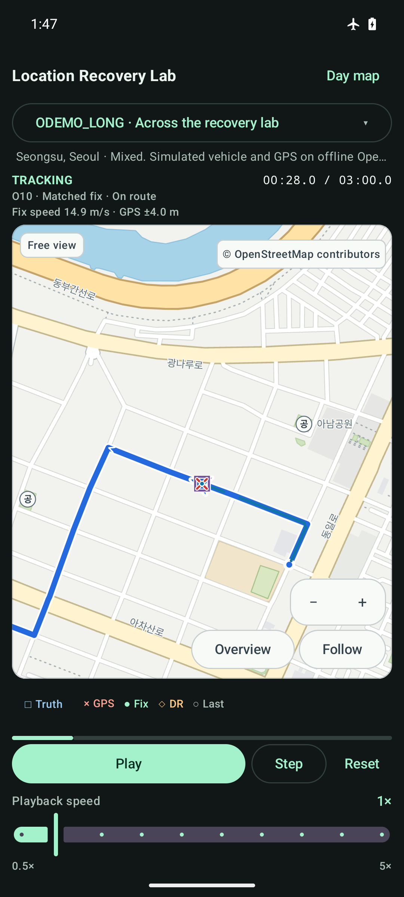
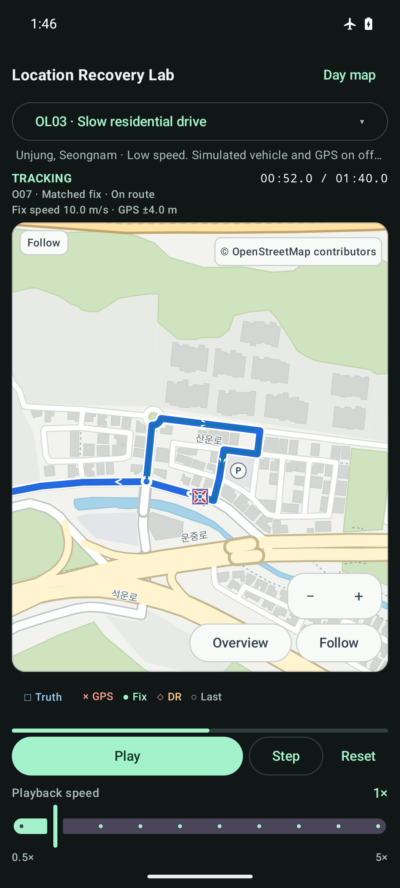

# 국내 OSM 지도 실행 화면과 시각 검증

[README](../README.md) · [실행 가이드](demo.md) · [렌더링 설계](korea-map-design.md)

## 성능 리팩터링 단계의 지도 화면

이 갤러리는 위치 복구 UI 개편 전에 확인한 지도 표현과 축척을 설명한다. 현재 UI의 정상 추적·추정·복구 화면은 OL07 시연에서 확인할 수 있다. [OL07 실행 화면](demo.md#ol07-시연)

  
  

성수동 O10 · Mid &nbsp; | &nbsp; 운중동 O07 · Follow

[Follow 10개](demo/refactor/follow-review.jpg) · [Mid 10개](demo/refactor/mid-review.jpg) · [Overview 10개](demo/refactor/overview-review.jpg)

원본은 보존하며 클릭 시 확대할 수 있다. 아래 표는 국내 OSM 전환 단계의 개별 캡처이며 후속 검수는 하단 기록에 있다.

## 10개 지역 상세 캡처

API 36 ARM64 에뮬레이터를 비행기 모드와 Wi-Fi 꺼짐 상태로 두고 1080×2400 세로 화면을 캡처했다. 각 지도에서 Follow, 두 번 축소한 Free(Mid), 계획 경로를 맞춘 Overview를 확인했다. 확대 수준에 따라 건물 상세, 시설 기호와 주요 도로의 노출이 바뀐다. 세 화면 모두 지도 모서리에 OSM 귀속이 표시된다.

| 지도 | 실제 실행 화면 | 확인한 요소 |
|---|---|---|
| O01 서울 여의도 | [Follow](demo/osm/O01-follow.png) · [Mid](demo/osm/O01-mid.png) · [Overview](demo/osm/O01-overview.png) | 한글 도로·여의도역과 도심 블록 |
| O02 성남 판교 나들목 | [Follow](demo/osm/O02-follow.png) · [Mid](demo/osm/O02-mid.png) · [Overview](demo/osm/O02-overview.png) | 램프·고속도로의 곡선과 레벨 |
| O03 서울 남산 | [Follow](demo/osm/O03-follow.png) · [Mid](demo/osm/O03-mid.png) · [Overview](demo/osm/O03-overview.png) | 실제 터널의 점선과 손실 중 추정 |
| O04 서울 삼성동 | [Follow](demo/osm/O04-follow.png) · [Mid](demo/osm/O04-mid.png) · [Overview](demo/osm/O04-overview.png) | 간선, 평행 생활도로, 삼성역 |
| O05 서울 수서 | [Follow](demo/osm/O05-follow.png) · [Mid](demo/osm/O05-mid.png) · [Overview](demo/osm/O05-overview.png) | 상하부 도로와 학교 영역·공원 이름 |
| O06 부산 수영강 | [Follow](demo/osm/O06-follow.png) · [Mid](demo/osm/O06-mid.png) · [Overview](demo/osm/O06-overview.png) | 하천, 양안을 잇는 교량과 교량 위 추정 |
| O07 성남 운중동 | [Follow](demo/osm/O07-follow.png) · [Mid](demo/osm/O07-mid.png) · [Overview](demo/osm/O07-overview.png) | 선정한 주거 구간의 건물 외곽과 주차장 |
| O08 부산 산복도로 | [Follow](demo/osm/O08-follow.png) · [Mid](demo/osm/O08-mid.png) · [Overview](demo/osm/O08-overview.png) | 촘촘한 주거 골목, 굴곡과 연결 도로 |
| O09 대전 둔산동 | [Follow](demo/osm/O09-follow.png) · [Mid](demo/osm/O09-mid.png) · [Overview](demo/osm/O09-overview.png) | 도심 격자, 공원, 주차장과 주유소 표기 |
| O10 서울 성수동 | [Follow](demo/osm/O10-follow.png) · [Mid](demo/osm/O10-mid.png) · [Overview](demo/osm/O10-overview.png) | 상업·주거 블록, 한글 도로명과 작은 도로 |

[여의도 야간](demo/osm/O01-night.png) · [성수동 야간](demo/osm/O10-night.png)

운중동 후보의 첫 탐색 기준은 건물 수가 적은 외곽 주행에 기울었다. 동일 지역의 데이터에서 건물이 모인 주거 구간을 선택해 저속·정차·재출발 사례를 재구성했다. 수영강 시나리오는 실제 교량 위에서 감속과 GPS 손실이 겹치도록 조정했다. [국내 데이터와 재현 방법](osm-data-pipeline.md)

## 성능 리팩터링 후 재검수

동일 API 36 세로 화면에서 10개 지도의 Follow·Mid·Overview를 다시 검수했다. 도로·한글 라벨·시설·귀속 위치가 유지되고 회복 중 진단 마커도 표시된다. [Follow 10개](demo/refactor/follow-review.jpg) · [Mid 10개](demo/refactor/mid-review.jpg) · [Overview 10개](demo/refactor/overview-review.jpg)

[O07 Follow 원본](demo/refactor/O07-follow.png) · [O10 Mid 원본](demo/refactor/O10-mid.png)
